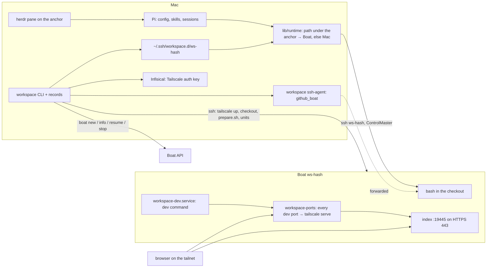

# workspace

A Rust CLI that gives every GitHub repository + branch its own disposable Boat sandbox. `workspace up` creates the Boat, clones the branch, installs dependencies, runs the dev server, serves every port it opens on `https://ws-<hash>.<tailnet>.ts.net:<port>`, and opens your local Pi on a directory that stands for the Boat. The Mac keeps Pi, its config and sessions; the code and every process live on the Boat.

```sh
cargo build --release
ln -s "$PWD/target/release/workspace" "$HOME/.local/bin/workspace"
workspace config                                   # create ~/.config/workspace/config.json
workspace up owner/repo feat/example --base main   # Boat, checkout, deps, dev server, ports, Pi in herdr
workspace ports owner/repo feat/example --json
workspace stop owner/repo feat/example
workspace resume owner/repo feat/example
```

## What lives where

| Mac | Boat |
| --- | --- |
| `workspace` CLI and its records (`~/.local/share/workspace/records`) | the checkout (`$HOME/work/<owner>-<repo>-<hash10>`) |
| Pi: config, skills, extensions, sessions | dependencies, dev server (`workspace-dev.service`) |
| the anchor `~/.ws/<owner>/<repo>/<branch>` (`.workspace.json` + mirrored `AGENTS.md`/`CLAUDE.md`/`.pi`) | port publisher (`workspace-ports.service`) and index (`workspace-index.service`) |
| `~/.ssh/workspace.d/ws-<hash10>` (current endpoint, host key, multiplexing) | Tailscale node `ws-<hash10>` (tailnet only, never Funnel) |
| ssh-agent `~/.ssh/workspace-agent.sock` holding only `~/.ssh/github_boat` | no key file: Git goes through the forwarded agent |



## Commands

| Command | Does |
| --- | --- |
| `up <repo> <branch> --base <b> [--no-open]` | create or resume, ssh block, tailnet, checkout, `prepare.sh`, dev unit, ports unit, index, anchor, then opens Pi in herdr. Re-runnable after any failure. |
| `create <repo> <branch> --base <b>` | the same up to the index, without prepare/dev/ports/anchor |
| `status` / `ports` | record, host, checkout path, index URL, sandbox state and published ports |
| `open` | focus the herdr workspace on the anchor, or create it and start Pi |
| `resume` | start the Boat; rewrite the ssh block (new endpoint and host key); re-enrol; restart dev and ports; re-mirror context files |
| `stop` | `tailscale logout` (frees the name at once), stop, wait for the snapshot |
| `ssh` | login shell in the checkout |
| `dev start\|stop\|restart\|logs` | control `workspace-dev.service` |
| `list` / `config` / `prune` | records; config; forget workspaces whose Boat is gone (record, ssh block, anchor) |

Add `--json` for pretty JSON. A Boat always uses `--type small` and stops itself after 7200 s.

## `workspace.toml`

Optional, at the repository root. Without it the CLI detects everything from the checkout.

```toml
[dev]
command = "pnpm dev"            # default: `<pm> run dev` when package.json has a dev script

[env]
infisical_project = "…"         # writes <checkout>/.env (0600) from `infisical export`
infisical_env = "dev"

[ports]
ignore = [9229, 9230]           # never published (here: Node inspectors)
```

Detection: package manager from `packageManager`, else the lockfile (pnpm, npm, bun, yarn); Node pin from `.nvmrc`, `.node-version` or `mise.toml` (mise installs it only when its major differs from the image's Node 24); `docker compose up -d` when a compose file exists; `.env.example` keys missing from `.env` are reported. No dev command and no `workspace.toml` → `up` stops and names the file to add.

## Dev servers behind Tailscale Serve

Serve proxies `https://ws-<hash>.<tailnet>.ts.net:<port>` to `http://localhost:<port>` on the Boat, so a dev server can keep listening on localhost. Ports in the kernel's ephemeral range (32768–60999) are skipped: tools bind those for internal plumbing. The first request to a new name waits a few seconds for the certificate.

- **Vite (and Astro, SvelteKit, …)**: the dev unit sets `__VITE_ADDITIONAL_SERVER_ALLOWED_HOSTS` to the tailnet name, and `TURBO_ENV_MODE=loose` so turbo's strict mode does not strip it. HMR runs over `wss://` through Serve.
- **Next.js 15.3+**: cross-origin dev requests need the tailnet name in `allowedDevOrigins` in `next.config`; add it in the project, the CLI does not patch repositories.

## Pi on the anchor

`workspace up` (or `open`) starts Pi in `~/.ws/<owner>/<repo>/<branch>`. The `tools/workspace` Pi extension and `extensions/lib/runtime` (in `~/.pi/agent`) make every path under the anchor, and every path under the Boat's home, run on the Boat: read/write/edit/ls/find through Pi's operation hooks, grep as Boat-side `rg`, bash and `!` commands over ssh (with `GH_TOKEN` from `gh auth token` on stdin), the footer's Git line, and `@file` completion. Anywhere else Pi is unchanged. A stopped Boat is resumed at session start; the footer shows `ws-<hash> · <package> :<port> · …`.

## Modules

- `src/domain.rs` — `Workspace` record, `Stage`, identity key, host `ws-<hash10>`, checkout path. No IO.
- `src/port.rs` — `Sandbox` (create, info, resume, stop, ssh_target), `Secrets` (get, dotenv), `Terminal` (open).
- `src/adapter/` — `boat.rs` (Boat CLI), `infisical.rs`, `herdr.rs`, `plain.rs`, `git.rs` (validation and checkout script).
- `src/remote.rs` runs commands over the alias written by `src/sshconfig.rs`; `src/ssh_agent.rs` keeps the forwarded agent; `src/tailscale.rs` enrols and logs out.
- `src/project.rs` (pure detection) → `src/prepare.rs` → `src/dev.rs`, `src/ports.rs`, `src/index.rs`, all installing units through `src/install.rs`; scripts and units live in `src/assets/`.
- `src/lifecycle.rs` and `src/up.rs` sequence the commands over `src/session.rs`; `src/anchor.rs` writes anchors; `src/registry.rs` is the only persistence.

## Configuration

`~/.config/workspace/config.json` (`WORKSPACE_CONFIG` overrides the path):

```json
{
  "infisical_project_id": "…",
  "infisical_env": "main",
  "tailscale_authkey_secret": "TAILSCALE_AUTHKEY_BOAT",
  "git_identity": "~/.ssh/github_boat",
  "anchor_root": "~/.ws",
  "terminal": "herdr"
}
```

`terminal` is `herdr` or `plain` (prints `cd <anchor> && pi`). The Tailscale key must be reusable, ephemeral and tagged. `~/.ssh/github_boat.pub` must be registered on the GitHub account. Infisical reads its login from the macOS keychain, so run `up`/`resume` from a normal terminal (herdr, a terminal app, ssh), not from a sandboxed agent shell.

## Contract diagram

`contract/contract.json` describes commands, ports, services, adapters, externals, types and invariants; `node contract/generate.mjs` validates it and regenerates `contract/index.html` (`node contract/serve.mjs` serves an editor that saves back). See `contract/README.md`.

## Invariants

- One Boat per repo+branch; `create`/`up` are idempotent and refuse to change the base.
- The Boat ID is recorded before any remote work; a crash during the first allocation blocks re-allocation (never a second paid box) — reconcile by hand with `boat list --all`.
- An existing branch keeps its commit; a new branch starts untracked from `origin/<base>`; an origin mismatch is refused.
- The Tailscale key travels on ssh stdin into `/dev/shm` only; `GH_TOKEN` travels on stdin only.
- Installers refuse to replace a systemd unit they did not write or another HTTPS 443 route.
- Nothing is deleted automatically except by `prune`, which only touches workspaces whose Boat is gone, and never a record without a Boat ID.
