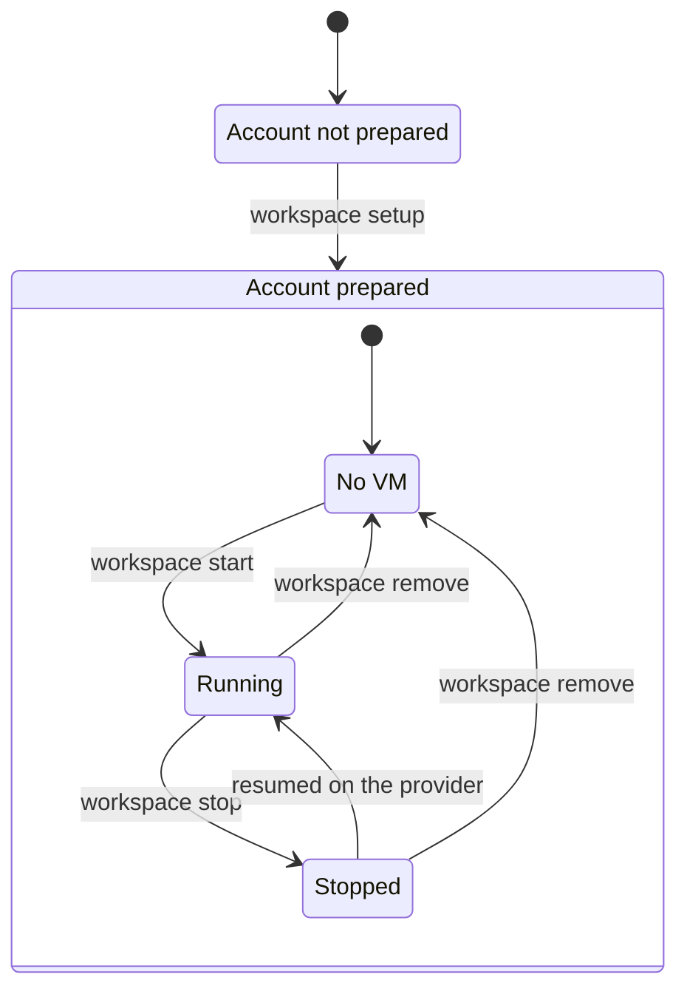

# workspace

`workspace` starts VMs on a cloud provider, sets them up with profiles, then stops or deletes them. It records every VM it creates on your disk, so a VM that runs and costs money cannot be lost.

## Quick start

```sh
cargo build --release
ln -s "$PWD/target/release/workspace" "$HOME/.local/bin/workspace"

workspace setup                       # once, to prepare the provider account
workspace start dev                   # prints the VM id
workspace stop dev                    # stops the VM and keeps its disk
workspace remove dev                  # deletes the VM and its data for good
workspace list                        # shows each recorded VM
```

`workspace --help` lists every command and option.

## How it works



1. `setup` prepares a provider account once, for example by creating what new VMs start from, then makes it the default provider. Running it again is safe.
2. `start` creates a VM, records it on your disk, waits until it answers, applies each profile in order, then prints the VM id.
3. `stop` stops the VM. Its disk and its record stay, so the VM can resume.
4. `remove` deletes the VM and its data, then its record.

A VM's name stands for its id in every command, and `list` prints both.

A provider is where VMs run, such as [Boat](docs/providers/boat.md). A profile is what a VM is for, such as an agent and its tools. Both are plugins that the core knows nothing about, as [Architecture](docs/architecture.md) explains. Their options come from flags or a config file, as [Configuration](docs/configuration.md) explains. To change the code, read [AGENTS.md](AGENTS.md), which holds the rules for people and coding agents alike.
