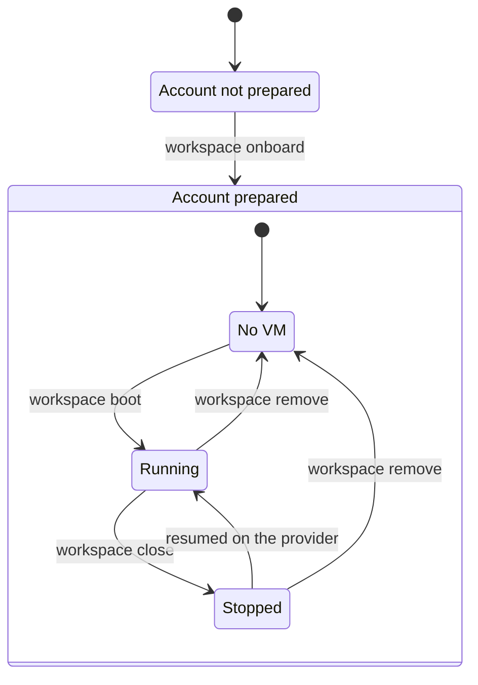

# workspace

`workspace` boots VMs on a cloud provider, sets them up with profiles, then stops or deletes them. It keeps a local record of every VM it boots, so a VM that runs and costs money is never forgotten.

It supports one provider today, [Boat](docs/providers/boat.md). No profile exists yet, so `boot` brings up a bare VM.

## Quick start

```sh
cargo build --release
ln -s "$PWD/target/release/workspace" "$HOME/.local/bin/workspace"

workspace onboard --provider boat     # once, to prepare your Boat account
workspace boot dev --provider boat    # prints the VM id, such as bx_8x7wbxub
workspace close bx_8x7wbxub           # stops the VM and keeps its disk
workspace remove bx_8x7wbxub          # deletes the VM and its data for good
```

## The big picture



You onboard once per provider account. After that, each VM goes back and forth between running and stopped until you remove it. A stopped VM still exists and keeps its record. Only `remove` deletes the VM and its record.

## Commands

| Command | What it does |
| --- | --- |
| `workspace onboard --provider <provider>` | Prepares the provider account, then prints what `boot` will do. Run it once, and again after you change options. It is safe to repeat. |
| `workspace boot <name> --provider <provider> [--profile <profile>]...` | Boots a VM, records it, waits until it answers, applies each profile in order, then prints its id. |
| `workspace close <id>` | Stops a recorded VM. Its disk and its record stay. |
| `workspace remove <id>` | Deletes a recorded VM and its data for good, then its record. |

`<name>` is 1 to 63 lowercase letters, digits or hyphens, with no hyphen at either end. Every command takes `--config <path>` to read options from another file than the default one. Provider options, such as `--boat-type`, are listed by `workspace boot --help`.

## Terms

| Term | Meaning |
| --- | --- |
| VM | A machine that `workspace` boots. Boat calls it a sandbox. |
| Provider | Where VMs run, such as Boat. Each provider is its own crate. |
| Profile | What a VM is for, such as an agent and its tools. A profile is applied after boot. Each profile is its own crate. |
| Record | A small local file per VM. It names the provider, so that `close` and `remove` can find the VM later. |
| Onboarding | Preparing the provider account once, before the first boot. |

## Documentation

| Read | To learn |
| --- | --- |
| [Architecture](docs/architecture.md) | How the code is split, what each command does step by step, and what a failure leaves behind |
| [Configuration](docs/configuration.md) | The config file, the flags, and which one wins |
| [Boat](docs/providers/boat.md) | How VMs run on Boat, what a sandbox gets from your account, and every limit |
| [Development](docs/development.md) | Checks, conventions, and how to add a provider or a profile |
