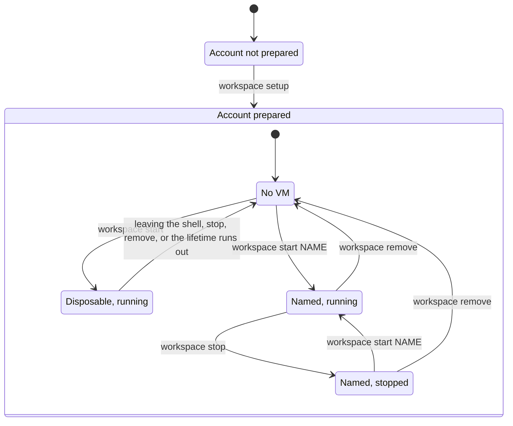

# workspace

`workspace` starts VMs on a cloud provider, sets them up with profiles, then stops or deletes them. A VM is disposable unless you name it: it is deleted when you leave it. A named VM is kept, so a later `start` resumes it. Every VM is recorded on your disk, so a VM that runs and costs money cannot be lost.

## Quick start

```sh
cargo build --release
ln -s "$PWD/target/release/workspace" "$HOME/.local/bin/workspace"

workspace setup                       # once, to prepare the provider account
workspace start                       # a disposable VM: a shell on it, deleted when you leave
workspace start --profile pi          # the same, with this machine's Pi installed on it
workspace start -d                    # prints its id instead; it lives until removed or its lifetime ends
workspace start dev                   # a kept VM named dev: created now, resumed by later starts
workspace stop dev                    # stops the VM and keeps its disk
workspace remove dev                  # deletes the VM and its data for good
workspace list                        # shows each recorded VM

workspace start image --profile pi --profile claude -d   # build an image once...
workspace snapshot image agent                           # ...save it under a name...
workspace remove image                                   # ...and set from = "agent" in the config: new VMs start ready
```

`workspace --help` lists every command and option.

## How it works



1. `setup` prepares a provider account once, for example by creating what new VMs start from, then makes it the default provider. Running it again is safe.
2. `start` creates a VM and records it on your disk. It waits until the VM answers, applies each profile in order, then opens a shell on it. With `-d`, it prints the VM id instead, for scripts.
   - Without a name, the VM is disposable: leaving the shell deletes it, and so does `stop`. With `-d`, it lives until `remove`, or until the provider's lifetime for it runs out, which deletes it too.
   - With a name, the VM is kept: leaving the shell leaves it running, and a later `start` of that name resumes it instead of creating another.
3. `stop` stops a named VM. Its disk and its record stay, so `start` can resume it.
4. `remove` deletes the VM and its data, then its record.
5. `snapshot` saves a VM under a name on the provider. Once the provider option that names a snapshot points at it, new VMs start from it, with everything the profiles installed already there, so a disposable VM is ready in seconds.

A VM's name stands for its id in every command, and `list` prints both, with `-` for a disposable VM.

A provider is where VMs run, such as [Boat](docs/providers/boat.md). A profile is what a VM is for, such as [Pi](docs/profiles/pi.md) or [Claude Code](docs/profiles/claude.md), set up as on this machine. Both are plugins that the core knows nothing about, as [Architecture](docs/architecture.md) explains. Their options come from flags or a config file, as [Configuration](docs/configuration.md) explains. To change the code, read [AGENTS.md](AGENTS.md), which holds the rules for people and coding agents alike.
