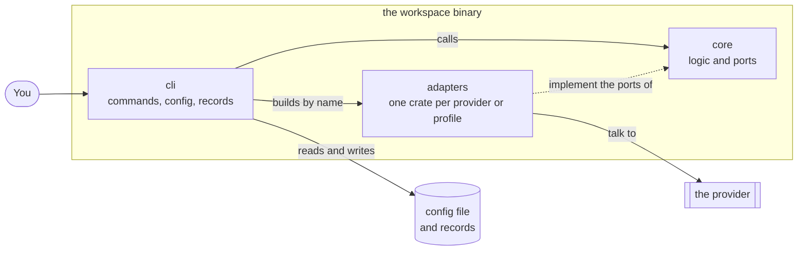
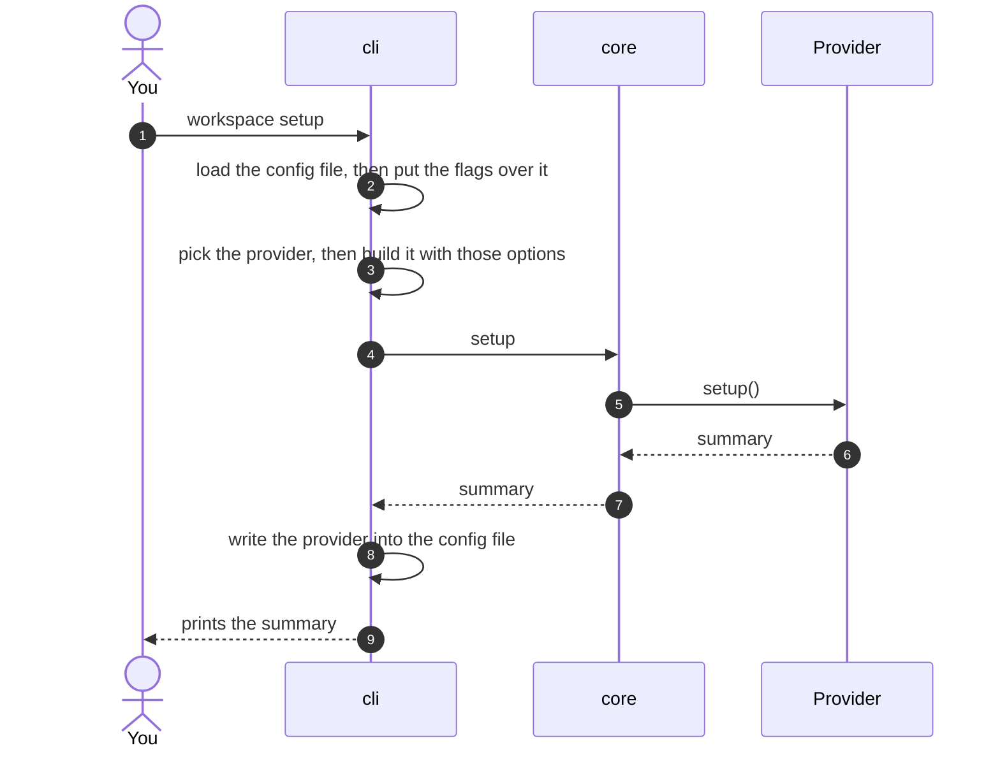
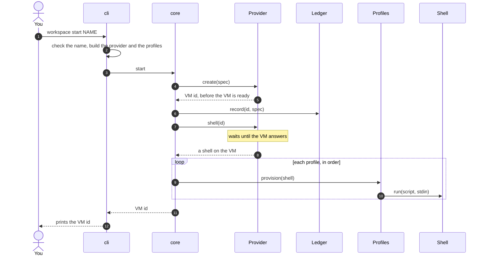
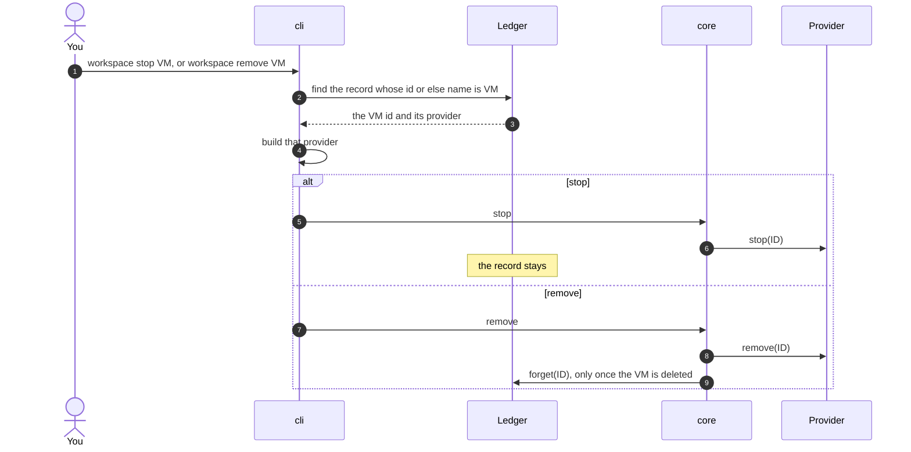
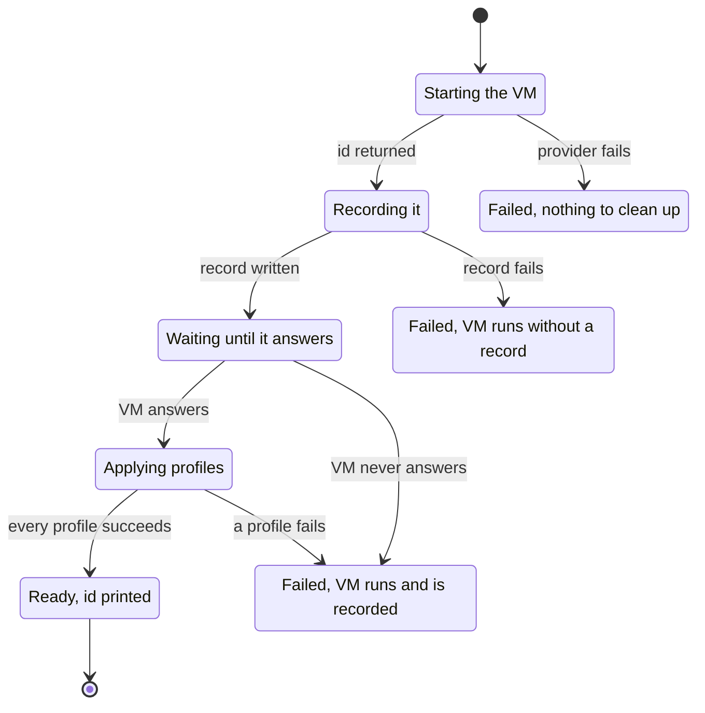
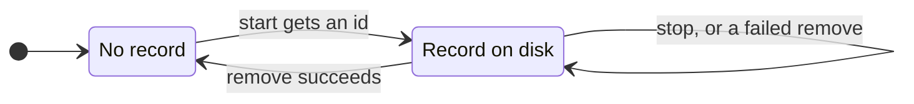

# Architecture

`workspace` follows ports and adapters. A small core holds the logic and knows no provider or profile. Adapters plug into it through traits, called ports, and the binary wires them together.

## The pieces



- **The core** does no IO and depends on no adapter, so the compiler rejects any import of one.
- **The cli** is the only part that knows every adapter. It builds them by the names given on the command line.
- **An adapter** depends on the core only. Adding one never changes the core.

## Ports

| Port | Contract |
| --- | --- |
| `Provider` | `setup` prepares the account and is safe to repeat. `create` returns the VM id as soon as the provider assigns one. `shell` waits until the VM answers. `stop` stops the VM, and succeeds when it is already stopped or gone. `remove` deletes it, and succeeds when it is already gone. |
| `Shell` | `run(script, stdin)` runs a script on the VM and returns its stdout. It fails on a non-zero exit. Secrets and files travel on stdin, never in the script. |
| `Profile` | `provision(shell)` sets up the VM. It must be safe to run twice. It sees only the shell, so it works the same on every provider. |
| `Ledger` | `record` runs before anything waits on the VM. `forget` runs once the VM is removed. The cli implements it with one file per VM. |

An adapter reports a failure as an opaque cause. The core wraps it in its own error without reading it, so no provider type leaks into the core. The binary prints the error, then one line per underlying cause.

## Commands step by step

### `setup`



The provider becomes the default only once its setup succeeds. A provider that is not ready never becomes the default.

### `start`



The record is written right after the provider returns the id, before anything waits. If you interrupt a start, the VM is already recorded.

### `stop` and `remove`



## How a start can end

Each step of a start can fail. What is left depends on how far it got.



Nothing is stopped for you. A failed VM keeps running and the error names it, so you decide whether to fix it, stop it or remove it. When the record itself fails, the error message is the only place the id appears.

## What a failure leaves behind

| Failure | What is left |
| --- | --- |
| The VM name is invalid | Nothing |
| The VM name is already recorded | Nothing |
| The provider cannot start the VM | Nothing |
| The record cannot be written | A running VM with no record. The error holds its id. |
| The VM never answers | A running, recorded VM |
| A profile fails | A running, recorded VM, as the failed step left it |
| Setup stops | The account as far as setup got, and the config file as it was. Run it again. |
| The stop does not finish | The VM may still run. The record stays. |
| The delete fails | The VM may still exist. The record stays, so `remove` can run again. |
| The VM is deleted but its record is not | No VM. Run `remove` again to delete the record. |

## Records

`start` writes one file per VM, named after the VM id, in `$XDG_DATA_HOME/workspace/vms/`, or in `~/.local/share/workspace/vms/` when `XDG_DATA_HOME` is unset. The file names the provider and the VM name:

```
provider=boat
name=dev
```

The file is written under a temporary name, then renamed, so it is never half written. After an interrupted start, `workspace list` shows the VM.

Since the record holds the name, `stop` and `remove` take the name in place of the id. A name means one VM: `start` refuses a name that is already recorded, before it creates anything. If older records share a name, a command given that name fails and lists their ids, so you pick one.



## Guarantees

- The record is written as soon as the provider returns the id. The only gap is inside `Provider::create`, between the provider starting the VM and returning its id, so adapters return the id as early as they can.
- A failure after the id never stops or deletes the VM.
- `stop` keeps the record, since a stopped VM still exists.
- `remove` deletes the record only after the provider confirms the VM is gone.
- Stopping a stopped or deleted VM succeeds, and so does removing a deleted one, so every command can be repeated.
