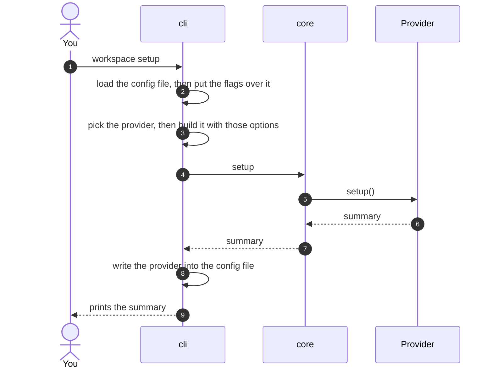
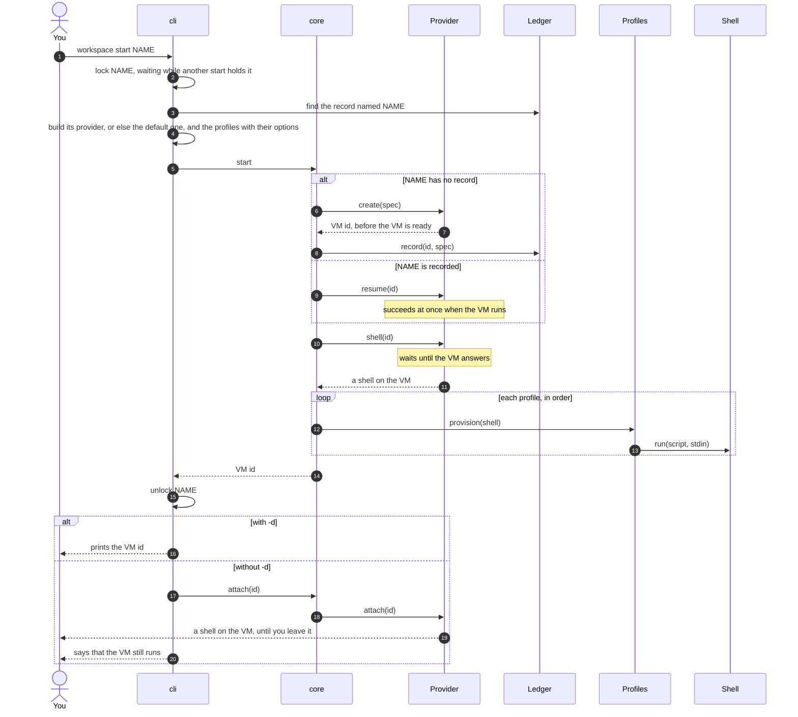
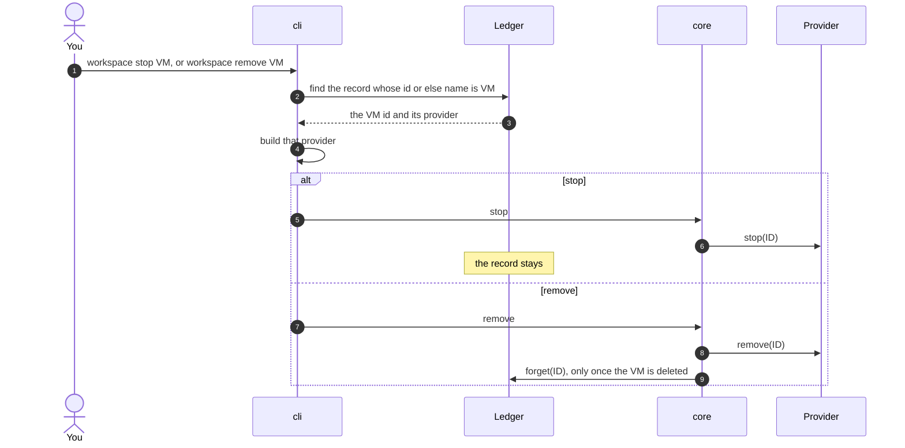
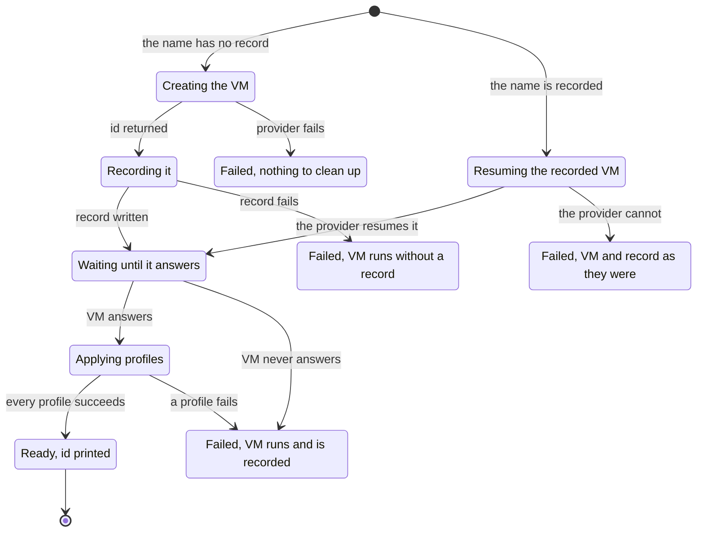
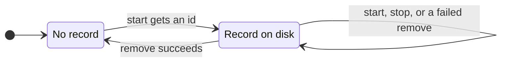

# Architecture

`workspace` follows ports and adapters. A small core holds the logic and knows no provider or profile. Adapters plug into it through traits, called ports, and the binary wires them together.

## The pieces


- **The core** does no IO and depends on no adapter, so the compiler rejects any import of one.
- **The cli** is the only part that knows every adapter. It builds them by the names given on the command line.
- **An adapter** depends on the core only. Adding one never changes the core.

## Ports

| Port | Contract |
| --- | --- |
| `Provider` | `setup` prepares the account and is safe to repeat. `create` returns the VM id as soon as the provider assigns one. `resume` makes a stopped VM run again, and succeeds when it already runs. `shell` waits until the VM answers. `attach` hands your terminal to a shell on the VM until you leave it. `stop` stops the VM, and succeeds when it is already stopped or gone. `remove` deletes it, and succeeds when it is already gone. |
| `Shell` | `run(script, stdin)` runs a script on the VM and returns its stdout. It fails on a non-zero exit. Secrets and files travel on stdin, never in the script. |
| `Profile` | `provision(shell)` sets up the VM. It must be safe to run twice. It sees only the shell, so it works the same on every provider. It may read this machine, such as the config of the agent it installs, and sends what it reads on stdin. |
| `Ledger` | `record` runs before anything waits on the VM. `forget` runs once the VM is removed. The cli implements it with one file per VM. |

A `Provider` reports a failure as an opaque cause, with a reason the core can act on: the account needs setup again, the provider no longer has the VM, or anything else. The core never reads the cause. It picks its error from the step and the reason, so no provider type leaks into the core, and the cli can say which command to run next. A VM the provider no longer has counts as stopped and as removed, so `stop` and `remove` can be repeated whatever the provider answers. The binary prints the error, then one line per underlying cause.

## Commands step by step

### `setup`



The provider becomes the default only once its setup succeeds. A provider that is not ready never becomes the default.

### `start`



The record is written right after the provider returns the id, before anything waits. If you interrupt a start, the VM is already recorded.

A recorded name never gets a second VM: `start` resumes the one it has, on the provider that created it. Starting a running VM therefore changes nothing. Two starts of one name at the same moment do not create two VMs either: the second waits until the first has recorded its VM and applied its profiles, then resumes that VM. The lock lasts only as long as the process that holds it, so an interrupted start never blocks the next one. Profiles apply each time you name them, since they are safe to repeat. Without `--profile`, nothing is applied again, and a resumed VM keeps on its disk what earlier profiles installed. Provider options apply when `start` creates a VM, and each provider's page says which ones also apply when it resumes one. `--provider` cannot move a recorded VM: naming another provider than its record's is an error.

Without `-d`, `start` ends by handing your terminal to a shell on the VM. Leaving the shell leaves the VM running, since an agent may still work on it, and `start` reminds you that it does. Without a terminal, such as in a script, `start` fails before it creates anything unless `-d` asks for the id instead.

### `stop` and `remove`



## How a start can end

Each step of a start can fail. What is left depends on how far it got.



Nothing is stopped for you. A failed VM keeps running and the error names it, so you decide whether to fix it, stop it or remove it. When the record itself fails, the error message is the only place the id appears.

## What a failure leaves behind

| Failure | What is left |
| --- | --- |
| The VM name is invalid | Nothing |
| The provider needs setup first | Nothing new. Run `setup`, then start again. |
| The provider no longer has the VM | Its record, which `remove` forgets. |
| The recorded VM cannot resume | The VM as it was, and its record. If the provider no longer has it, `remove` forgets the record. |
| The provider cannot start the VM | Nothing |
| The record cannot be written | A running VM with no record. The error holds its id. |
| The VM never answers | A recorded VM, which may still run |
| The shell cannot open | The VM as it was, and its record. `start` opens the shell again, resuming the VM first if it stopped. |
| A profile fails | A running, recorded VM, as the failed step left it |
| Setup stops | The account as far as setup got, and the config file as it was. Run it again. |
| The stop does not finish | The VM may still run. The record stays. |
| The delete fails | The VM may still exist. The record stays, so `remove` can run again. |
| The VM is deleted but its record is not | No VM. Run `remove` again to delete the record. |

## Records

`start` writes one file per VM, named after the VM id, under the XDG data directory. The file names the provider and the VM name:

```
provider=boat
name=dev
```

The file is written under a temporary name, then renamed, so it is never half written. After an interrupted start, `workspace list` shows the VM.

A file that cannot be read, say after a hand edit, never hides the others. `list` prints every VM it can read, then names each file it cannot and fails, so a script notices. Until that file is fixed or deleted, a name that no readable record holds cannot be looked up, since the unreadable file might hold it, and `start` would create a second VM. A name that a readable record holds works as usual.

Since the record holds the name, `stop` and `remove` take the name in place of the id. A name means one VM: when a name is recorded, `start` resumes that VM rather than create another. If older records share a name, a command given that name fails and lists their ids, so you pick one.



## Guarantees

- The record is written as soon as the provider returns the id. The only gap is inside `Provider::create`, between the provider starting the VM and returning its id, so adapters return the id as early as they can.
- A failure after the id never stops or deletes the VM.
- `stop` keeps the record, since a stopped VM still exists, and `start` resumes it rather than create another.
- `remove` deletes the record only after the provider confirms the VM is gone.
- Stopping a stopped or deleted VM succeeds, and so does removing a deleted one, so every command can be repeated.
