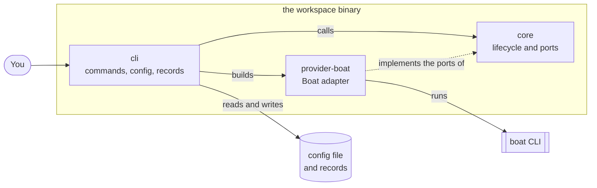
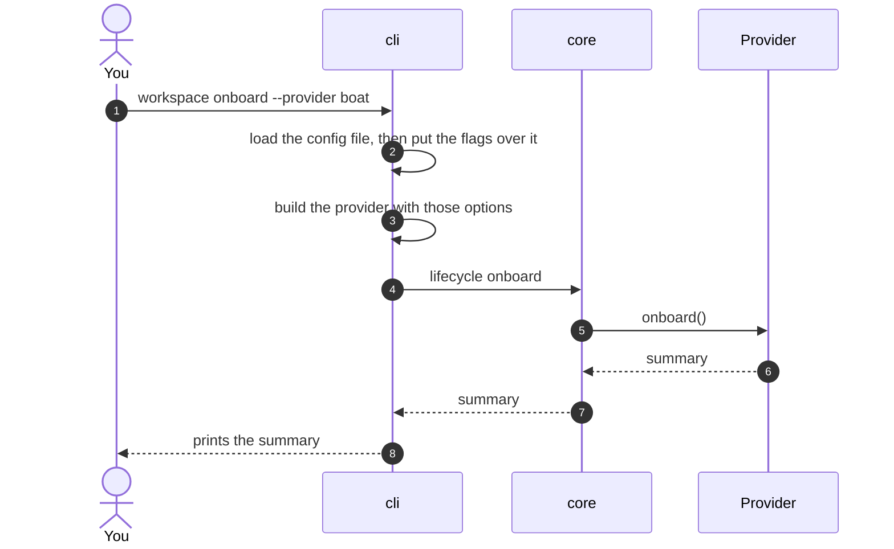
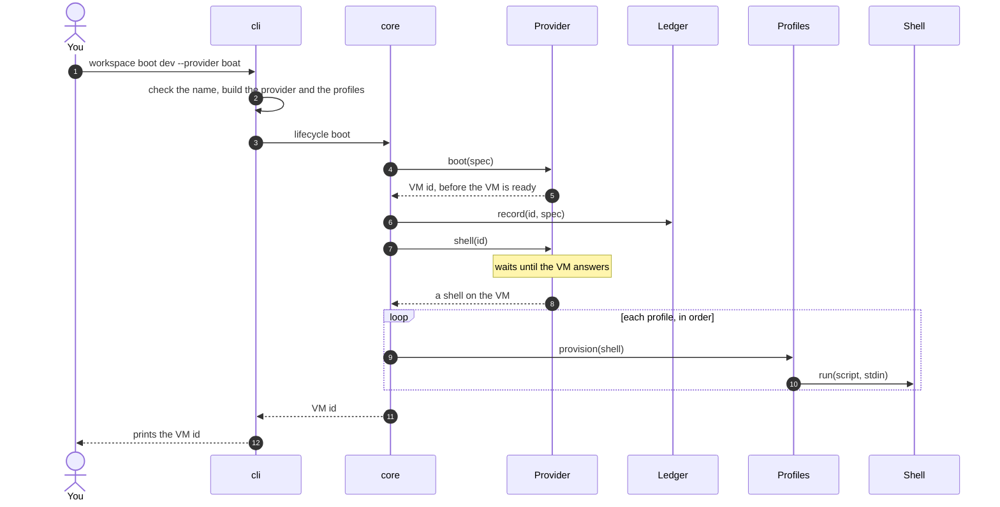
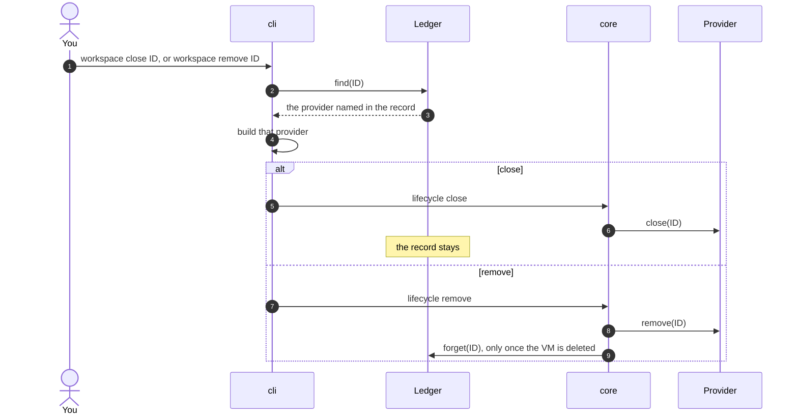
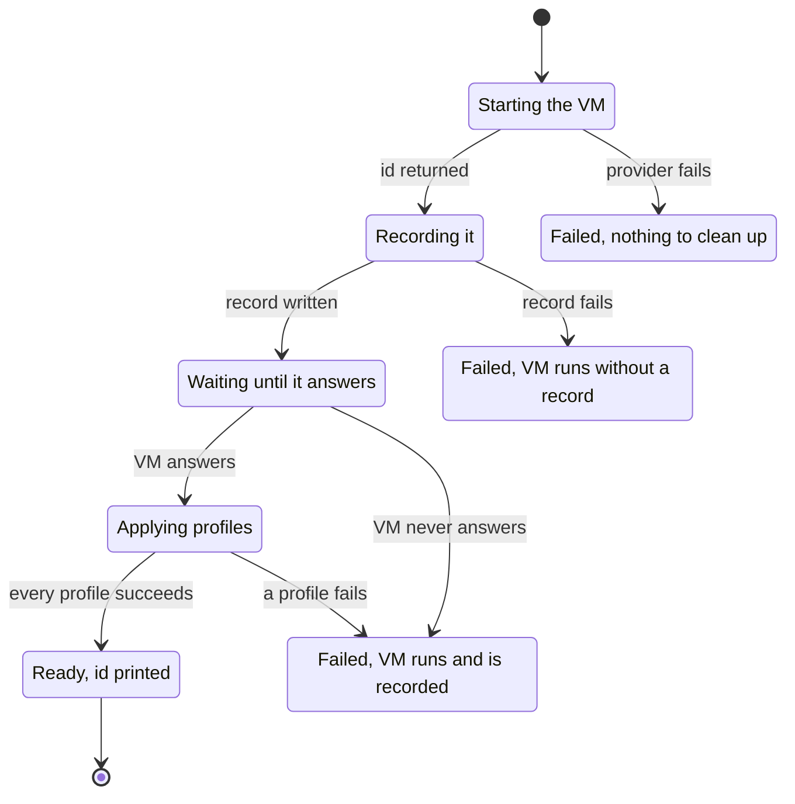
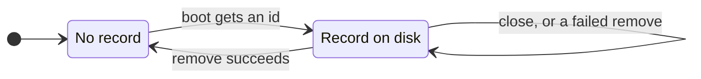

# Architecture

`workspace` follows ports and adapters, the Rust version of hexagonal architecture. A small core holds the logic and knows no provider. Providers and profiles are adapters that plug into it.

## The pieces



| Crate | Role | Depends on |
| --- | --- | --- |
| `core` (`workspace-core`) | The logic: onboard, boot, close, remove. It defines the ports and does no IO. | nothing in this repo |
| `cli` (`workspace`) | The binary. It reads the command line and the config file, picks adapters by name, keeps the records, and calls the core. | `core`, every adapter |
| `provider-boat` | Runs VMs as Boat sandboxes, through the `boat` CLI. | `core` |

The core's `Cargo.toml` lists no adapter, so the compiler rejects any import of one. Adding a provider never changes the core.

## Ports

A port is a trait in `crates/core/src/port.rs`. Adapters implement it, and the core calls only the trait.

| Port | Implemented by | Contract |
| --- | --- | --- |
| `Provider` | Boat | `onboard` prepares the account and is safe to repeat. `boot` returns the VM id as soon as the provider assigns one. `shell` waits until the VM answers. `close` stops the VM, and succeeds when it is already stopped or gone. `remove` deletes it, and succeeds when it is already gone. |
| `Shell` | the provider's transport, such as ssh | `run(script, stdin)` returns stdout, and fails on a non-zero exit. Secrets and files travel on stdin, never in the script. |
| `Profile` | none yet | `provision(shell)` sets up the VM. It must be safe to run twice. It sees only the shell, so it works the same on every provider. |
| `Ledger` | `FileLedger`, in the CLI | `record` runs before anything waits on the VM. `forget` runs once the VM is removed. |

An adapter reports a failure as a `Cause`: a boxed error that the core wraps in its own `Error` without reading it. No provider type reaches the core.

## Commands step by step

### `onboard`



### `boot`



The record is written right after the provider returns the id, before anything waits. If you interrupt a boot, the VM is already recorded.

### `close` and `remove`



## How a boot can end

Each step of a boot can fail. What is left depends on how far it got.



Nothing is closed for you. A failed VM keeps running, and the error names it, so you decide whether to fix it, close it or remove it. When the record itself fails, the error message is the only place the id appears.

## What a failure leaves behind

An error prints on an `error:` line, then one `caused by:` line per underlying cause. The last cause usually comes from the adapter:

```console
$ workspace boot dev --provider boat
error: could not boot `dev`
  caused by: the Boat environment `workspace` does not exist: `workspace onboard --provider boat` creates it
```

| Error | Meaning | What is left |
| --- | --- | --- |
| invalid name | The VM name is not a DNS label. | Nothing |
| could not boot | The provider did not start a VM. | Nothing |
| booted but could not record it | The record file could not be written. | A running VM with no record. The message holds its id. |
| booted but could not reach it | The VM never answered. | A running, recorded VM |
| profile failed | A profile's step failed. | A running, recorded VM, as the failed step left it |
| not ready to boot VMs | Onboarding stopped. | The account as far as onboarding got. Run it again. |
| could not close | The stop did not finish. | The VM may still run. The record stays. |
| could not remove | The delete failed. | The VM may still exist. The record stays, so you can run `remove` again. |
| removed but could not delete its record | The record file stayed. | No VM. Run `remove` again to delete the record. |

## Records

`boot` writes one file per VM in `$XDG_DATA_HOME/workspace/vms/`, or in `~/.local/share/workspace/vms/` when `XDG_DATA_HOME` is unset. The file is named after the VM id:

```
provider=boat
name=dev
```

The file is written to a temporary name, then renamed, so it is never half written. To find a VM after an interrupted boot, list that directory.



## Guarantees

- The record is written as soon as the provider returns the id. The only gap is inside `Provider::boot`, between the provider starting the VM and returning its id, so adapters return the id as early as they can.
- A failure after the id never stops or deletes the VM.
- `close` keeps the record, since a stopped VM still exists.
- `remove` deletes the record only after the provider confirms the VM is gone.
- Closing a stopped or deleted VM succeeds, and so does removing a deleted one, so you can repeat any command.
