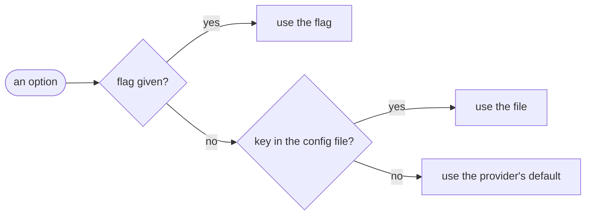

# Configuration

Providers take options, such as the machine type. You set an option with a flag, in the config file, or not at all.

## Which value wins



A flag lasts for one command. The file holds what you want every time.

## The config file

| Situation | File read |
| --- | --- |
| `--config <path>` given | That file. It must exist. |
| `XDG_CONFIG_HOME` set | `$XDG_CONFIG_HOME/workspace/config.toml` |
| Otherwise | `~/.config/workspace/config.toml` |

The default file is optional. Without it, every option keeps its default.

Each provider reads its own table under `[providers]`:

```toml
[providers.boat]
type = "small"
ttl = "8h"
environment = "workspace"
```

[Boat's page](providers/boat.md#options) lists its options, their flags and their defaults.

## Mistakes are errors

An unknown key, an unknown table or a bad value stops the command, and the error points at the line:

```console
$ workspace boot dev --provider boat
error: /home/you/.config/workspace/config.toml is not a valid config file
  caused by: TOML parse error at line 2, column 1
  |
2 | typ = "large"
  | ^^^
unknown field `typ`, expected one of `type`, `ttl`, `environment`
```

Every command reads the file, `close` and `remove` included, so a broken file blocks them too until you fix it. A typo never goes unnoticed this way.
