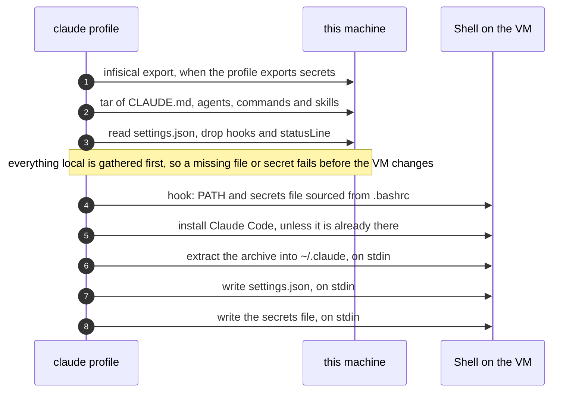

# Claude Code

The `claude` profile gives a VM this machine's Claude Code setup: its instructions, skills, agents and commands, its settings as far as they make sense away from this machine, and the token that lets `claude -p` work without a browser. It is safe to run again.

## What it does



Claude Code is installed with its own installer into `~/.local/bin` when the VM lacks it. Boat's image already ships it, so there the step changes nothing. The installed version is whatever is current, since Claude Code updates itself.

## What the VM gets

| Mirrored | Kept local |
| --- | --- |
| `~/.claude/CLAUDE.md`, `agents`, `commands`, `skills` | `projects`, `sessions`, `history.jsonl`, `plugins`, caches |
| `~/.claude/settings.json` without `hooks` and `statusLine`, which run programs of this machine | `~/.claude.json`, which holds this machine's account and project state |

Symbolic links are followed, so skills that link into Pi's skills arrive as files. A listed entry that this machine lacks is skipped.

## Signing in without a browser

Claude Code signs in through a browser, and keeps the result in this machine's keychain, which does not travel. For a VM, make a long-lived token once on this machine, and store it in Infisical under `CLAUDE_CODE_OAUTH_TOKEN`:

```sh
claude setup-token
infisical secrets set CLAUDE_CODE_OAUTH_TOKEN='…' --projectId <project> --env <env>
```

The profile exports it in every shell on the VM, so `claude` and `claude -p` are signed in there. Without it, `claude -p` on the VM answers `Not logged in`.

## Secrets

Secrets travel as the [Pi profile](pi.md#secrets) describes, through the same file on the VM, with the same `env:` prefix for a value read from this machine's environment. Each profile replaces only the names it owns.

| Flag | Config key | What it sets |
| --- | --- | --- |
| `--claude-infisical-project` | `infisical_project` | The Infisical project the secrets come from. Required when a secret comes from Infisical. |
| `--claude-infisical-env` | `infisical_env` | The Infisical environment, `dev` by default. |
| `--claude-secrets` | `secrets` | The secrets to export, `CLAUDE_CODE_OAUTH_TOKEN` and `GITHUB_TOKEN` by default. `secrets = []` in the config file exports none. |

```toml
[profiles.claude]
infisical_project = "…"
infisical_env = "main"
```
