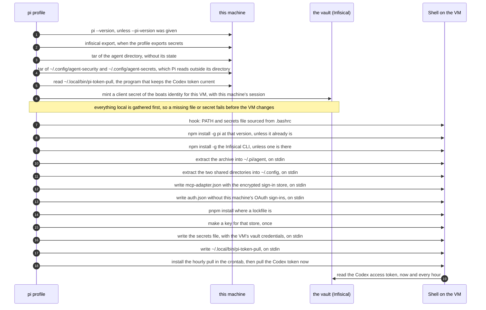

# Pi

The `pi` profile turns a VM into this machine's Pi: the same version, the same agent directory, the same model and MCP configuration, with the dependencies installed. It is safe to run again, and each run brings the VM up to date with this machine.

## What it does



Each step is one script over the provider's shell. A script fails on its first error, and the error says what failed on the VM.

## What the VM gets

The archive holds what Pi reads from `~/.pi/agent`, and leaves what Pi writes there, such as sessions, caches, trust decisions and installed dependencies:

| Mirrored | Kept local |
| --- | --- |
| `AGENTS.md`, `ARCHITECTURE.md`, `agents`, `prompts`, `skills`, `skills.json`, `themes`, `keybindings.json` | `sessions`, `trust.json`, `crashes.json`, `run-history.jsonl` |
| `extensions`, `packages`, `bin`, `npm`, `package.json`, `pnpm-lock.yaml`, `pnpm-workspace.yaml`, `tsconfig.json`, `oxfmt.config.ts`, `oxlint.config.ts` | every `node_modules`, which `pnpm install` recreates on the VM |
| `settings.json`, `models.json`, `mcp.json`, `mcp-adapter.json`, `lazy-load.json`, `context-budget.json`, `frontend-check.json`, `plans` | `mcp-cache.json`, `mcp-npx-cache.json`, `models-store.json`, `mcp-auth.json` |

Symbolic links are followed, so the VM gets files where this machine has links. A listed entry that this machine lacks is skipped.

Two directories outside `~/.pi/agent` travel as well, and both are required rather than skipped, since a machine without them fails before the VM changes:

- `~/.config/agent-security`: the `secret-output` extension imports the policy it shares with Claude's hook from there, so Pi cannot start without it.
- `~/.config/agent-secrets`: the vault binding that `bin/provider-key.py` and `pi-token-pull` read. It names the project, the environment, the paths and the identities, never a value.

`models.json` and `mcp-adapter.json` hold API keys, so they travel on stdin, inside the archive, and land with the modes they have here. `auth.json` is written apart, mode 0600: the VM gets this machine's API keys, never its OAuth sign-ins. The next two sections say how the VM reads the vault, and how it signs in anyway.

## The VM's own vault access

Every provider API key named in `models.json` resolves on the VM as it does here: `bin/provider-key.py` runs the Infisical CLI, which the profile installs on the VM when it is missing. The CLI needs a machine identity, and the VM gets its own credential for it rather than this machine's.

The binding's `clients.boats.identityId` names `boats`, a read-only identity made for cloud VMs alone, apart from the one this machine uses. For each run, the profile asks the vault, with this machine's own Infisical session (`infisical login`), for a new client secret of that identity, described as `boats VM`, valid thirty days. The session token reaches `curl` as a config file on stdin, never as an argument. The identity's client id and the new client secret go to the VM's secrets file as `INFISICAL_UNIVERSAL_AUTH_CLIENT_ID` and `INFISICAL_UNIVERSAL_AUTH_CLIENT_SECRET`, where the Infisical CLI and `pi-token-pull` read them.

So a VM never holds a credential that outlives it by much, this machine's own identity never leaves it, and revoking one VM is deleting one client secret in the vault. A binding without `clients.boats`, a machine without a CLI session, or a vault that refuses the mint, each fail before the VM changes, with an error that says which.

## OAuth sign-ins

An API key can be copied to as many VMs as you like. An OAuth session cannot: its refresh token is exclusive. Whoever refreshes gets a new one and the old one dies, so a second holder that refreshes ends the session of the first. Only the machine that signed in therefore keeps the refresh token, and only it refreshes, through Pi itself. A VM gets the access token, which any number of holders may use at once until it expires, and an empty refresh token in its place, so that it never tries.

The access token reaches the VM from the vault, not from this machine. The machine that signed in publishes it there every hour, under the secret the binding names as `clients.pi.oauth.codex`. The profile copies this machine's `~/.local/bin/pi-token-pull` to the same path on the VM, puts an hourly line in the VM's crontab that sources the secrets file and runs it, and runs it once at the end, so the VM starts with a token. The program reads the token with the VM's own identity, and writes the `openai-codex` entry of `~/.pi/agent/auth.json`, which Pi rereads without a restart. Its log is `~/.local/state/pi-token-pull.log` on the VM. A VM without `cron` fails at that step, and says so.

The VM has no keychain, and without one Pi's MCP adapter refuses to remember anything and reports every OAuth server as an error at each start. The profile therefore sets `oauthCredentialStore` to `encrypted-file` in the VM's `mcp-adapter.json`, and makes a key for it once, kept in the secrets file as `PI_MCP_ADAPTER_OAUTH_FILE_KEY`. An MCP server that needs a sign-in gets one on the VM, with `/mcp-auth <server>` in Pi, which shows a link to open here and asks for the callback URL back; until then Pi notes once that the server needs a sign-in, and stays quiet about it in later sessions. A server whose access tokens live about an hour is a poor fit for that; a static token in its `headers` serves it better.

A `packages` entry of `settings.json` that points outside the agent directory does not exist on the VM, and Pi warns about it at start.

## Secrets

The profile exports secrets as environment variables in every shell on the VM, for the tools the agent runs, such as `gh` or an MCP server. A name such as `GITHUB_TOKEN` is read with the Infisical CLI of this machine, which must be signed in. A name with the `env:` prefix, such as `env:MY_TOKEN`, is read from this machine's environment instead, for what Infisical cannot hold. They are written to `~/.config/workspace/secrets.env` on the VM, mode 0600, which `.bashrc` sources first thing, so that the shells ssh starts get them too, and so does the hourly token pull. A rerun replaces the names it owns and leaves the others. When `GITHUB_TOKEN` is among them, `gh auth setup-git` makes Git use it.

| Flag | Config key | What it sets |
| --- | --- | --- |
| `--pi-version` | `version` | The Pi version to install. It defaults to the version this machine runs, so the extensions written against it work. |
| `--pi-infisical-project` | `infisical_project` | The Infisical project the secrets come from. Required when a secret comes from Infisical. |
| `--pi-infisical-env` | `infisical_env` | The Infisical environment, `dev` by default. |
| `--pi-secrets` | `secrets` | The secrets to export, `GITHUB_TOKEN` by default. `secrets = []` in the config file exports none, and then Infisical's export is never called. |

```toml
[profiles.pi]
infisical_project = "…"
infisical_env = "main"
secrets = ["GITHUB_TOKEN"]
```

A secret the project lacks is an error that names it, before the VM changes.
