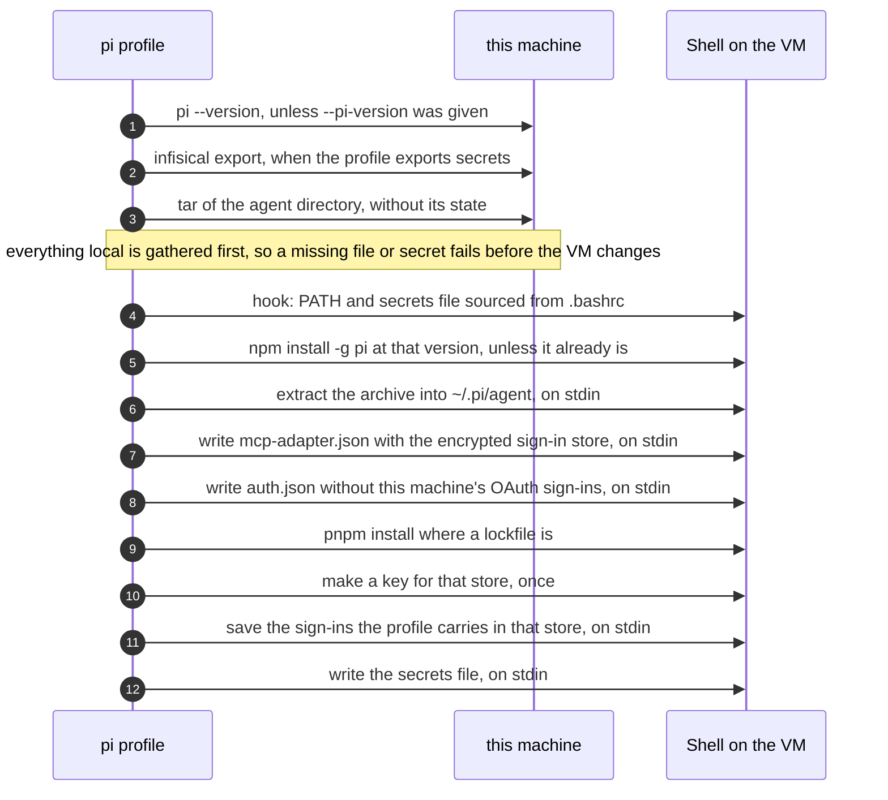

# Pi

The `pi` profile turns a VM into this machine's Pi: the same version, the same agent directory, the same model and MCP configuration, with the dependencies installed. It is safe to run again, and each run brings the VM up to date with this machine.

## What it does



Each step is one script over the provider's shell. A script fails on its first error, and the error says what failed on the VM.

## What the VM gets

The archive holds what Pi reads from `~/.pi/agent`, and leaves what Pi writes there, such as sessions, caches, trust decisions and installed dependencies:

| Mirrored | Kept local |
| --- | --- |
| `AGENTS.md`, `ARCHITECTURE.md`, `agents`, `prompts`, `skills`, `skills.json`, `themes`, `keybindings.json` | `sessions`, `trust.json`, `crashes.json`, `run-history.jsonl` |
| `extensions`, `packages`, `bin`, `npm`, `package.json`, `pnpm-lock.yaml`, `pnpm-workspace.yaml`, `tsconfig.json`, `oxfmt.config.ts`, `oxlint.config.ts` | every `node_modules`, which `pnpm install` recreates on the VM |
| `settings.json`, `models.json`, `mcp.json`, `mcp-adapter.json`, `lazy-load.json`, `context-budget.json`, `frontend-check.json`, `plans` | `mcp-cache.json`, `mcp-npx-cache.json`, `models-store.json`, `mcp-auth.json` |

Symbolic links are followed, so the VM gets files where this machine has links. A listed entry that this machine lacks is skipped.

`models.json` and `mcp-adapter.json` hold API keys, so they travel on stdin, inside the archive, and land with the modes they have here. `auth.json` is written apart, mode 0600: the VM gets this machine's API keys, never its OAuth sign-ins. The next section says why, and how a VM signs in anyway.

## OAuth sign-ins

An API key can be copied to as many VMs as you like. An OAuth session cannot: its refresh token is exclusive. Whoever refreshes gets a new one and the old one dies, so a second holder that refreshes ends the session of the first. Only this machine therefore keeps refresh tokens, and only this machine refreshes, through Pi itself. A VM gets access tokens, which any number of holders may use at once until they expire, and a placeholder in place of each refresh token, so that it never tries.

The access tokens reach the VM as Infisical secrets, through the `oauth` option, which pairs each sign-in with the secret that holds it:

- `codex=SECRET` fills the `openai-codex` entry of the VM's `auth.json` from a secret that holds a JSON object with `access`, `expires` in milliseconds and `accountId`, as this machine's `auth.json` has them.
- `SERVER=SECRET` saves a sign-in for the MCP server of that name in the VM's encrypted store, from a secret that holds a JSON object with `serverUrl` and `tokens`, where `tokens` has `accessToken` and may have `expiresAt` in seconds, `scope` and `issuer`, as the adapter stores them. A `refreshToken` in the secret is dropped.

A job on this machine keeps those secrets fresh, from Pi's own auth file and the adapter's keychain entries, and refreshes a session through Pi's code when its access token nears its end, so that a VM started at any time gets a token with a useful life ahead. That job is outside this project, since it reads this machine's stores. A VM whose access token expires stops reaching that service, and the next `workspace start` on it gives it the token of the day.

The VM has no keychain, and without one Pi's MCP adapter refuses to remember anything and reports every OAuth server as an error at each start. The profile therefore sets `oauthCredentialStore` to `encrypted-file` in the VM's `mcp-adapter.json`, and makes a key for it once, kept in the secrets file as `PI_MCP_ADAPTER_OAUTH_FILE_KEY`. The sign-ins the profile carries are saved there through the adapter's own code. A server the profile carries no sign-in for still works with one on the VM, with `/mcp-auth <server>` in Pi, which shows a link to open here and asks for the callback URL back; until then Pi notes once that the server needs a sign-in, and stays quiet about it in later sessions. A server whose access tokens live about an hour is a poor fit for carried sign-ins; a static token in its `headers` serves it better.

A `packages` entry of `settings.json` that points outside the agent directory does not exist on the VM, and Pi warns about it at start.

## Secrets

The profile exports secrets as environment variables in every shell on the VM, for the tools the agent runs, such as `gh` or an MCP server. A name such as `GITHUB_TOKEN` is read with the Infisical CLI of this machine, which must be signed in. A name with the `env:` prefix, such as `env:INFISICAL_UNIVERSAL_AUTH_CLIENT_ID`, is read from this machine's environment instead, for what Infisical cannot hold, like the credentials that reach Infisical itself. They are written to `~/.config/workspace/secrets.env` on the VM, mode 0600, which `.bashrc` sources first thing, so that the shells ssh starts get them too. A rerun replaces the names it owns and leaves the others. When `GITHUB_TOKEN` is among them, `gh auth setup-git` makes Git use it.

| Flag | Config key | What it sets |
| --- | --- | --- |
| `--pi-version` | `version` | The Pi version to install. It defaults to the version this machine runs, so the extensions written against it work. |
| `--pi-infisical-project` | `infisical_project` | The Infisical project the secrets come from. Required when a secret comes from Infisical. |
| `--pi-infisical-env` | `infisical_env` | The Infisical environment, `dev` by default. |
| `--pi-secrets` | `secrets` | The secrets to export, `GITHUB_TOKEN` by default. `secrets = []` in the config file exports none, and then Infisical is never called. |
| `--pi-oauth` | `oauth` | The sign-ins to carry, as `codex=SECRET` or `SERVER=SECRET` pairs, none by default. Their secrets come from the same project and environment, and fill files rather than the environment. |

```toml
[profiles.pi]
infisical_project = "…"
infisical_env = "main"
secrets = ["GITHUB_TOKEN", "env:INFISICAL_UNIVERSAL_AUTH_CLIENT_ID", "env:INFISICAL_UNIVERSAL_AUTH_CLIENT_SECRET"]
oauth = ["codex=PI_OAUTH_CODEX", "jira=PI_MCP_OAUTH_JIRA"]
```

A secret the project lacks is an error that names it, before the VM changes. So is a sign-in secret that does not hold what the list above describes.
