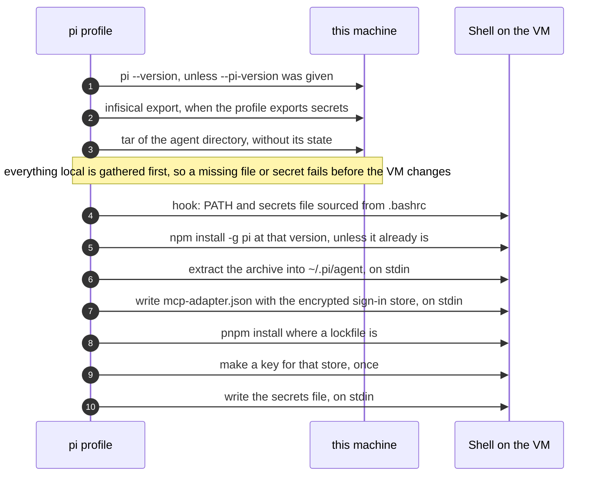

# Pi

The `pi` profile turns a VM into this machine's Pi: the same version, the same agent directory, the same model and MCP configuration, with the dependencies installed. It is safe to run again, and each run brings the VM up to date with this machine.

## What it does



Each step is one script over the provider's shell. A script fails on its first error, and the error says what failed on the VM.

## What the VM gets

The archive holds what Pi reads from `~/.pi/agent`, and leaves what Pi writes there, such as sessions, caches, trust decisions and installed dependencies:

| Mirrored | Kept local |
| --- | --- |
| `AGENTS.md`, `ARCHITECTURE.md`, `agents`, `prompts`, `skills`, `skills.json`, `themes`, `keybindings.json` | `sessions`, `trust.json`, `crashes.json`, `run-history.jsonl` |
| `extensions`, `packages`, `bin`, `npm`, `package.json`, `pnpm-lock.yaml`, `pnpm-workspace.yaml`, `tsconfig.json`, `oxfmt.config.ts`, `oxlint.config.ts` | every `node_modules`, which `pnpm install` recreates on the VM |
| `settings.json`, `models.json`, `auth.json`, `mcp.json`, `mcp-adapter.json`, `mcp-auth.json`, `lazy-load.json`, `context-budget.json`, `frontend-check.json`, `plans` | `mcp-cache.json`, `mcp-npx-cache.json`, `models-store.json` |

Symbolic links are followed, so the VM gets files where this machine has links. A listed entry that this machine lacks is skipped.

`auth.json`, `models.json` and `mcp-adapter.json` hold API keys, so they travel on stdin, inside the archive, and land with the modes they have here.

OAuth sign-ins of MCP servers live in this machine's keychain, not in a file, so they do not travel. The VM has no keychain either, and without one Pi's MCP adapter refuses to remember anything and reports every such server as an error at each start. The profile therefore sets `oauthCredentialStore` to `encrypted-file` in the VM's `mcp-adapter.json`, and makes a key for it once, kept in the secrets file as `PI_MCP_ADAPTER_OAUTH_FILE_KEY`. Such a server then needs one sign-in on the VM, with `/mcp-auth <server>` in Pi, which shows a link to open here and asks for the callback URL back. Until then Pi notes once that the server needs a sign-in, and stays quiet about it in later sessions. A snapshot taken after the sign-in carries it to every VM started from it.

A `packages` entry of `settings.json` that points outside the agent directory does not exist on the VM, and Pi warns about it at start.

## Secrets

The profile exports secrets as environment variables in every shell on the VM, for the tools the agent runs, such as `gh` or an MCP server. A name such as `GITHUB_TOKEN` is read with the Infisical CLI of this machine, which must be signed in. A name with the `env:` prefix, such as `env:INFISICAL_UNIVERSAL_AUTH_CLIENT_ID`, is read from this machine's environment instead, for what Infisical cannot hold, like the credentials that reach Infisical itself. They are written to `~/.config/workspace/secrets.env` on the VM, mode 0600, which `.bashrc` sources first thing, so that the shells ssh starts get them too. A rerun replaces the names it owns and leaves the others. When `GITHUB_TOKEN` is among them, `gh auth setup-git` makes Git use it.

| Flag | Config key | What it sets |
| --- | --- | --- |
| `--pi-version` | `version` | The Pi version to install. It defaults to the version this machine runs, so the extensions written against it work. |
| `--pi-infisical-project` | `infisical_project` | The Infisical project the secrets come from. Required when a secret comes from Infisical. |
| `--pi-infisical-env` | `infisical_env` | The Infisical environment, `dev` by default. |
| `--pi-secrets` | `secrets` | The secrets to export, `GITHUB_TOKEN` by default. `secrets = []` in the config file exports none, and then Infisical is never called. |

```toml
[profiles.pi]
infisical_project = "…"
infisical_env = "main"
secrets = ["GITHUB_TOKEN", "env:INFISICAL_UNIVERSAL_AUTH_CLIENT_ID", "env:INFISICAL_UNIVERSAL_AUTH_CLIENT_SECRET"]
```

A secret the project lacks is an error that names it, before the VM changes.
