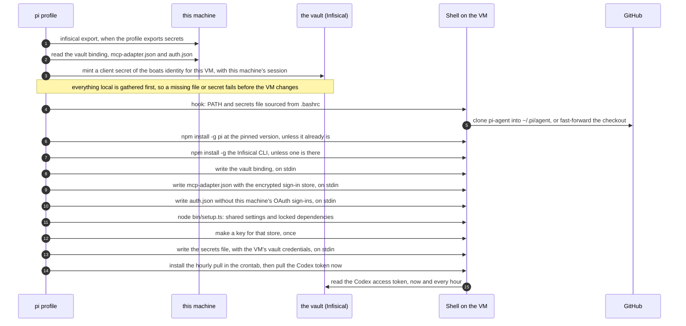

# Pi

The `pi` profile turns a VM into a Pi workstation: the agent directory comes from the public [`NextNodeSolutions/pi-agent`](https://github.com/NextNodeSolutions/pi-agent) repository, Pi is the version that repository pins, and this machine contributes only what belongs to it: the vault binding, the MCP adapter's settings, API keys, and a vault credential minted for the VM. It is safe to run again, and each run brings the VM's checkout up to date with the repository.

## What it does



Each step is one script over the provider's shell. A script fails on its first error, and the error says what failed on the VM.

## The agent directory

The VM reads the agent directory from the repository, never from this machine, so a VM works the same whichever machine started it, and a change reaches VMs by being pushed, not by being copied.

- **No checkout yet.** The repository is cloned into `~/.pi/agent`. A directory already there without Git, such as one Pi made at its first start, is adopted in place: the files the repository tracks replace those on the VM, leftovers in the folders it tracks are removed, and what the repository ignores stays, such as sessions, sign-ins and installed dependencies.
- **A checkout.** It only fast-forwards. Work done on the VM is never overwritten: when it blocks the update, the step fails and says to commit, stash or drop it on the VM.

`bin/setup.ts` in the checkout then merges the repository's pinned settings into the VM's `settings.json`, creates it from the repository's defaults when missing, and installs the locked dependencies. Pi installs its own `npm:` packages at its first start.

A client overlay under `client/` stays on the machine that holds it: the repository is public, and client material never leaves its machine, so a VM runs without it.

## What this machine sends

| File | Why it comes from this machine |
| --- | --- |
| `~/.config/agent-secrets/core-vault.json` | The vault binding that `bin/provider-key.py` and `bin/pi-token-pull` read. It names the project, the environment, the paths and the identities, never a value. |
| `~/.pi/agent/mcp-adapter.json` | Untracked, since it may hold API keys. It lands mode 0600, with the encrypted sign-in store set. |
| `~/.pi/agent/auth.json` | Pi's API keys, mode 0600, never this machine's OAuth sign-ins. |

The next two sections say how the VM reads the vault, and how it signs in anyway.

## The VM's own vault access

Every provider API key named in `models.json` resolves on the VM as it does here: `bin/provider-key.py` runs the Infisical CLI, which the profile installs on the VM when it is missing. The CLI needs a machine identity, and the VM gets its own credential for it rather than this machine's.

The binding's `clients.boats.identityId` names `boats`, a read-only identity made for cloud VMs alone, apart from the one this machine uses. For each run, the profile asks the vault, with this machine's own Infisical session (`infisical login`), for a new client secret of that identity, described as `boats VM`, valid thirty days. The session token reaches `curl` as a config file on stdin, never as an argument. The identity's client id and the new client secret go to the VM's secrets file as `INFISICAL_UNIVERSAL_AUTH_CLIENT_ID` and `INFISICAL_UNIVERSAL_AUTH_CLIENT_SECRET`, where the Infisical CLI and `pi-token-pull` read them.

So a VM never holds a credential that outlives it by much, this machine's own identity never leaves it, and revoking one VM is deleting one client secret in the vault. A binding without `clients.boats`, a machine without a CLI session, or a vault that refuses the mint, each fail before the VM changes, with an error that says which.

## OAuth sign-ins

An API key can be copied to as many VMs as you like. An OAuth session cannot: its refresh token is exclusive. Whoever refreshes gets a new one and the old one dies, so a second holder that refreshes ends the session of the first. Only the machine that signed in therefore keeps the refresh token, and only it refreshes, through Pi itself. A VM gets the access token, which any number of holders may use at once until it expires, and an empty refresh token in its place, so that it never tries.

The access token reaches the VM from the vault, not from this machine. The machine that signed in publishes it there every hour, under the secret the binding names as `clients.pi.oauth.codex`. The VM runs `bin/pi-token-pull` from its checkout, the program the publishing machine runs too: the profile puts an hourly line in the VM's crontab that sources the secrets file and runs it, and runs it once at the end, so the VM starts with a token. The program reads the token with the VM's own identity, and writes the `openai-codex` entry of `~/.pi/agent/auth.json`, which Pi rereads without a restart. Its log is `~/.local/state/pi-token-pull.log` on the VM. A VM without `cron` fails at that step, and says so.

The VM has no keychain, and without one Pi's MCP adapter refuses to remember anything and reports every OAuth server as an error at each start. The profile therefore sets `oauthCredentialStore` to `encrypted-file` in the VM's `mcp-adapter.json`, and makes a key for it once, kept in the secrets file as `PI_MCP_ADAPTER_OAUTH_FILE_KEY`. An MCP server that needs a sign-in gets one on the VM, with `/mcp-auth <server>` in Pi, which shows a link to open here and asks for the callback URL back; until then Pi notes once that the server needs a sign-in, and stays quiet about it in later sessions. A server whose access tokens live about an hour is a poor fit for that; a static token in its `headers` serves it better.

## Secrets

The profile exports secrets as environment variables in every shell on the VM, for the tools the agent runs, such as `gh` or an MCP server. A name such as `GITHUB_TOKEN` is read with the Infisical CLI of this machine, which must be signed in. A name with the `env:` prefix, such as `env:MY_TOKEN`, is read from this machine's environment instead, for what Infisical cannot hold. They are written to `~/.config/workspace/secrets.env` on the VM, mode 0600, which `.bashrc` sources first thing, so that the shells ssh starts get them too, and so does the hourly token pull. A rerun replaces the names it owns and leaves the others. When `GITHUB_TOKEN` is among them, `gh auth setup-git` makes Git use it.

| Flag | Config key | What it sets |
| --- | --- | --- |
| `--pi-version` | `version` | The Pi version to install. It defaults to the exact version the repository's `package.json` pins, since the extensions were written against it. |
| `--pi-infisical-project` | `infisical_project` | The Infisical project the secrets come from. Required when a secret comes from Infisical. |
| `--pi-infisical-env` | `infisical_env` | The Infisical environment, `dev` by default. |
| `--pi-secrets` | `secrets` | The secrets to export, `GITHUB_TOKEN` by default. `secrets = []` in the config file exports none, and then Infisical's export is never called. |

```toml
[profiles.pi]
infisical_project = "…"
infisical_env = "main"
secrets = ["GITHUB_TOKEN"]
```

A secret the project lacks is an error that names it, before the VM changes.
