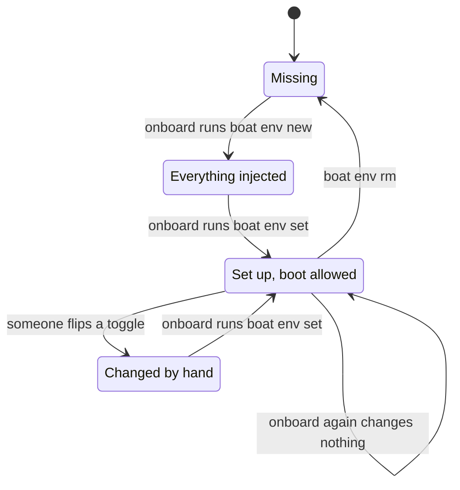
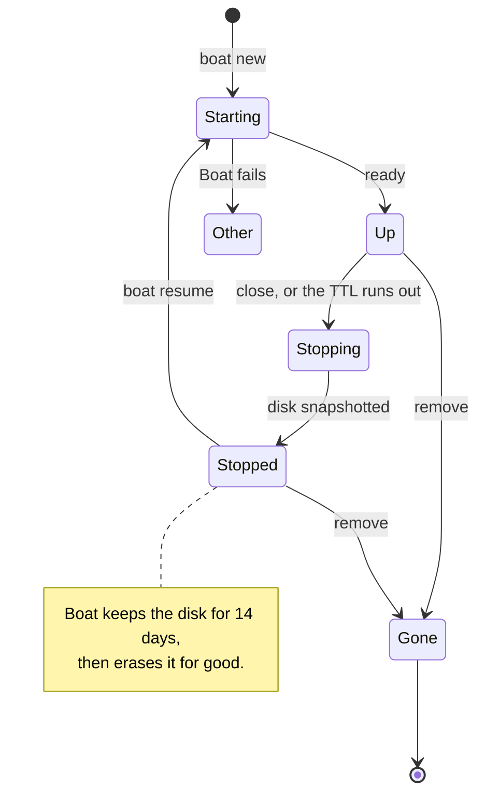
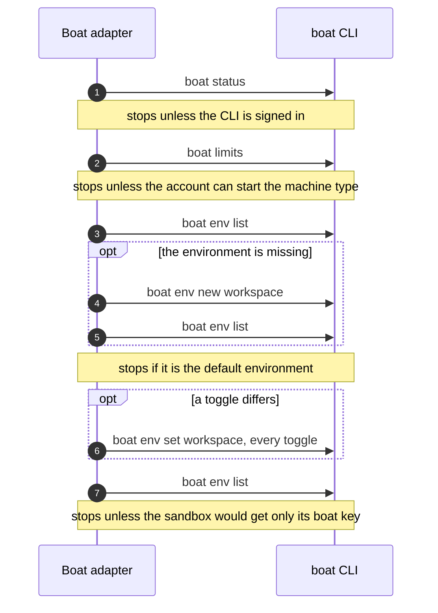
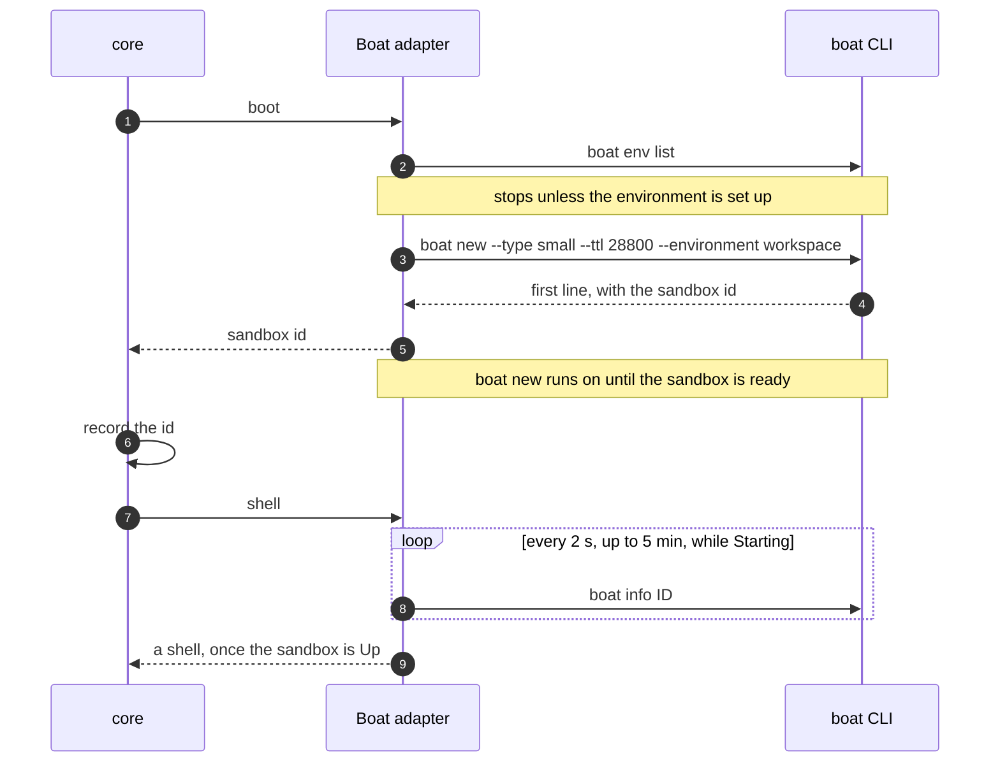
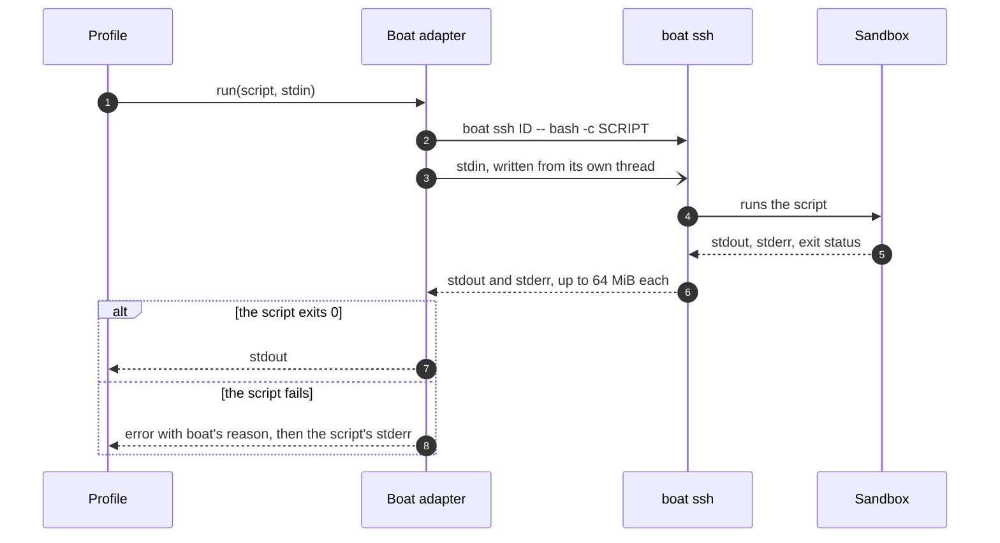
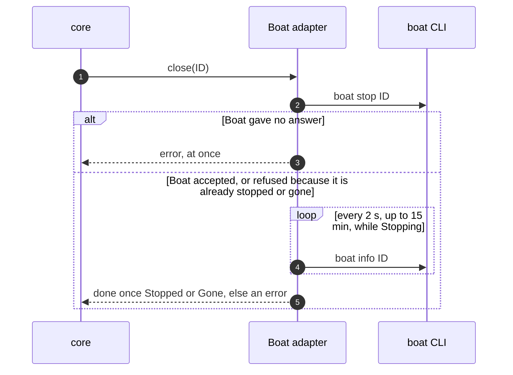
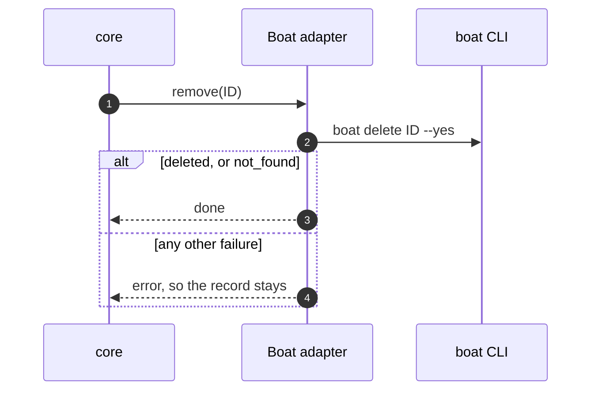
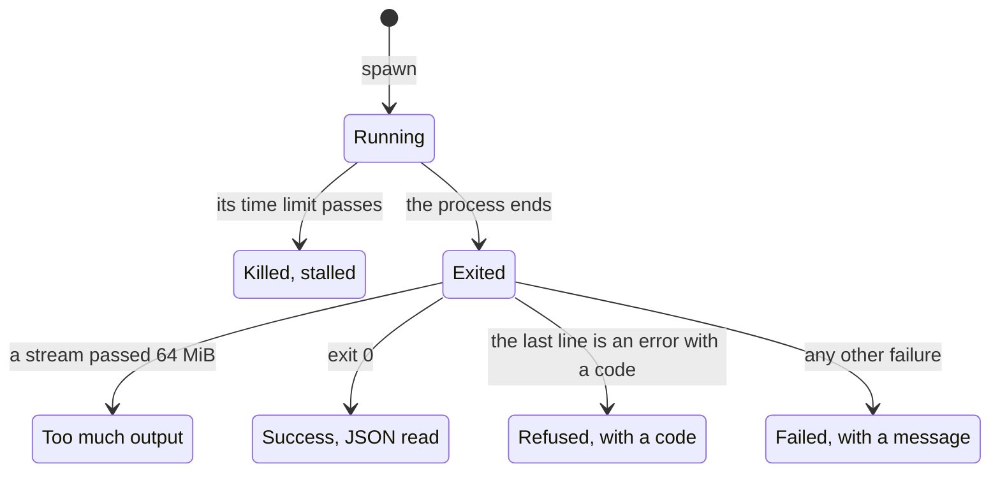

# Boat

With `--provider boat`, each VM is a [Boat](https://boat.dev) sandbox. The adapter drives the `boat` CLI and reads everything it prints. Nothing from Boat reaches your terminal or the core, except through the adapter's own errors.

## Before you start

1. Install the Boat CLI and put it on your `PATH`.
2. Sign in with `boat login`. `boat status` shows whether you are signed in.
3. Run `workspace onboard --provider boat` once. Run it again after you change an option.

## Options

| Flag | Config key | Default | What it sets |
| --- | --- | --- | --- |
| `--boat-type` | `type` | `small` | The machine size: `small` (2 vCPU, 4 GB, half rate), `default` (4 vCPU, 8 GB), `large` (8 vCPU, 16 GB, twice the rate) or `xlarge` (16 vCPU, 32 GB, $100/month plan or higher). |
| `--boat-ttl` | `ttl` | `8h` | How long after boot Boat stops the sandbox, even mid-work. A positive whole number followed by `d`, `h`, `m` or `s`, such as `90m`. |
| `--boat-environment` | `environment` | `workspace` | The Boat environment the sandboxes start from. ASCII letters, digits, dots, dashes and underscores. |

Config keys go under `[providers.boat]`. See [Configuration](../configuration.md).

The TTL is a hard limit. Boat's timer counts time since boot, and cannot tell whether an agent is still working. Stopping a sandbox soon after its agent goes idle is a job for the profile that runs the agent.

## What a sandbox gets from your account

A Boat environment decides what a sandbox receives from your account. Boat's default environment, `base`, can pass your GitHub access, agent logins and secrets. `workspace` keeps its own environment instead, which passes one thing only:

| Toggle | Set to | Why |
| --- | --- | --- |
| Master switch (`safe-for-third-parties`) | off | When on, it withholds everything, the boat key included. |
| GitHub access | off | |
| Secrets (variables and files) | off | |
| Agent logins (Claude, Codex) | off | |
| Boat key | on | The key is scoped to its own sandbox, so the sandbox can stop itself but cannot reach any other. |

`onboard` creates the environment and keeps it in that shape. `boot` refuses to start from it otherwise.



- `boot` works only in the Set up state. Anywhere else it fails before it creates anything, and says what differs.
- Each `boat env set` creates a new version of the environment. New sandboxes start from the latest version. Running ones keep theirs.
- `onboard` never touches the account's default environment, since your other sandboxes start from it.

## Sandbox states

Boat has more states than the adapter needs, so the adapter groups them:

| Adapter state | Boat's names | Meaning |
| --- | --- | --- |
| Starting | `init`, `provisioning`, `provisioned` (the CLI shows `starting`), `cloning` | Boat is setting the machine up. |
| Up | `ready`, `idle`, `running` | It accepts ssh. |
| Stopping | `stopping`, `archiving` | Boat is snapshotting the disk before it stops the machine. |
| Stopped | `stopped`, `archived` | Nothing runs, and the disk is kept. |
| Gone | answers `not_found` | Deleted, or never existed |
| Other | `error`, `cancelled`, any other | Something went wrong on Boat's side. |



A stopped sandbox costs nothing. Within 14 days, `boat resume <id>` brings it back. After that, Boat erases the disk and the sandbox can no longer resume.

## What each operation does

### `onboard`



It then prints the machine type, the TTL, and whether it created, reset or kept the environment:

```console
$ workspace onboard --provider boat
Boat is ready: `workspace boot` starts small sandboxes, which Boat stops 8h after boot.
They start from the Boat environment `workspace` (created now), which gives them their own boat key and nothing else from the account.
```

### `boot`



The adapter returns the id from the first line `boat new` prints, about a second before the sandbox is ready. That keeps the window without a record as short as possible. `shell` then waits through the starting states, and fails at once on a stopped, deleted or failed sandbox.

### `Shell::run`, used by profiles



A script has no time limit, since provisioning can take long. It fails once stdout or stderr passes 64 MiB.

### `close`



### `remove`



## One call to the boat CLI

Every call adds `--json --no-update`, and one module owns every `boat` process:



- **Refused** means the Boat API said no. Its code drives decisions: `not_found` means the sandbox is gone.
- **Failed** carries the message from boat's last JSON line, or its stderr when there is none.
- **Stalled**: after a kill, the threads that read the pipes are left behind, so a leftover child process that holds a pipe open cannot delay the error.
- **Too much output**: past the limit, the rest of a stream is read and dropped, so the command never blocks on a full pipe.

## Limits

| What | Limit |
| --- | --- |
| A call that only talks to the Boat API (`info`, `stop`, `delete`, `status`, `limits`, `env`) | Killed after 60 s |
| `boat new` | Killed if it prints no id within 60 s. The error tells you to check `boat list`. |
| Waiting for a sandbox to start | 5 min |
| Waiting for a sandbox to stop | 15 min, to leave time for the disk snapshot |
| Polling while waiting | Every 2 s |
| A script run over ssh | No time limit, 64 MiB per output stream |
| A stopped sandbox's disk | Kept 14 days |

## Design choices

- **ssh, not exec.** `boat exec` takes no stdin, caps a command at 600 s, and Boat keeps the command and output of every exec for 90 days. Secrets would end up stored there. `boat ssh` forwards stdin and has none of these limits.
- **`small` by default**, per the operator's sizing rule. A larger type is a choice you make in the config or with a flag.
- **The VM name lives only in the record.** Boat names sandboxes itself.

## What the adapter relies on

Observed with Boat CLI 1.0.39. If Boat changes one of these, the adapter needs a change too.

- `boat new` prints `{"event":"created","id":...}` first, and `ready` about a second later.
- A failing command ends its stdout with `{"error":...,"event":"error"}`. That line has a `code` only when the Boat API refused.
- `boat ssh` forwards stdin and the remote stderr, and quotes each argument for the remote shell. It exits 1 whatever the script's exit code, with the reason in that last line.
- `boat stop` on a stopping sandbox returns the same operation. On a stopped one it fails with `stop_failed`, and on a deleted one with `not_found`.
- `boat delete` works on a running or a stopped sandbox. `boat info` answers `not_found` right after.
- `boat env list` gives each environment's toggles, its `effective` values and `isDefault`. `boat env new` starts with everything injected. `boat env set` takes `--safe-for-third-parties`, `--github`, `--secrets`, `--agents-credentials` and `--boat-credentials`.
- A sandbox's boat key is scoped to that sandbox only.
