# Boat

On the `boat` provider, each VM is a [Boat](https://boat.dev) sandbox. The adapter drives the `boat` CLI, reads everything it prints, and turns every failure into its own error. Boat's output never reaches your terminal or the core, but for the shell that `start` opens for you.

## Before you start

1. Install the Boat CLI, put it on your `PATH`, and sign in with `boat login`.
2. Run `workspace setup --provider boat`. It prepares your account and makes Boat the default provider. Run it again whenever you change an option.

## Options

| Flag | Config key | What it sets |
| --- | --- | --- |
| `--boat-type` | `type` | The machine size. It defaults to the smallest. A larger one is a choice you make here. |
| `--boat-ttl` | `ttl` | How long after it starts Boat stops the sandbox, such as `90m` or `8h`. The timer starts again on each resume. |
| `--boat-environment` | `environment` | The Boat environment that sandboxes start from |
| `--boat-from` | `from` | The saved snapshot that new sandboxes start from, as `workspace snapshot` saves it. Without it, they start from Boat's base image. |

`workspace start --help` shows the accepted values and the defaults. `setup` checks that your Boat plan allows the machine type. The machine type is chosen when `start` creates a sandbox. The TTL and the environment also apply each time `start` resumes one.

A disposable VM is created with `--no-snapshots`: Boat keeps no disk for it, so a stop erases it and nothing is left to pay for or to clean up. Boat charges per second while a sandbox runs; create, resume, fork and stop cost nothing, and a stopped kept sandbox costs nothing either. Saved snapshots are included in the plan, ten of them on the $20 plan, and each one beyond that costs $1.70 a month, so `workspace snapshot` reuses one name rather than inventing new ones.

The TTL is a ceiling, not an idle timer. Boat stops the sandbox when it runs out, even mid-work, because its timer cannot tell whether an agent is still busy. Stopping a sandbox once its agent goes idle is the job of the profile that runs the agent.

## What a sandbox gets from your account

A Boat environment decides what a sandbox receives from your account. Boat's default environment can pass your GitHub access, agent logins and secrets. `workspace` uses an environment of its own, so that a sandbox gets one thing only:

| What Boat can pass | In workspace's environment |
| --- | --- |
| GitHub access | off |
| Secrets, as variables and files | off |
| Agent logins | off |
| The sandbox's own boat key | on |

The boat key reaches only its own sandbox, so the sandbox can stop itself and nothing else. Boat also has a master switch that withholds everything. It stays off, since it would withhold that key too.

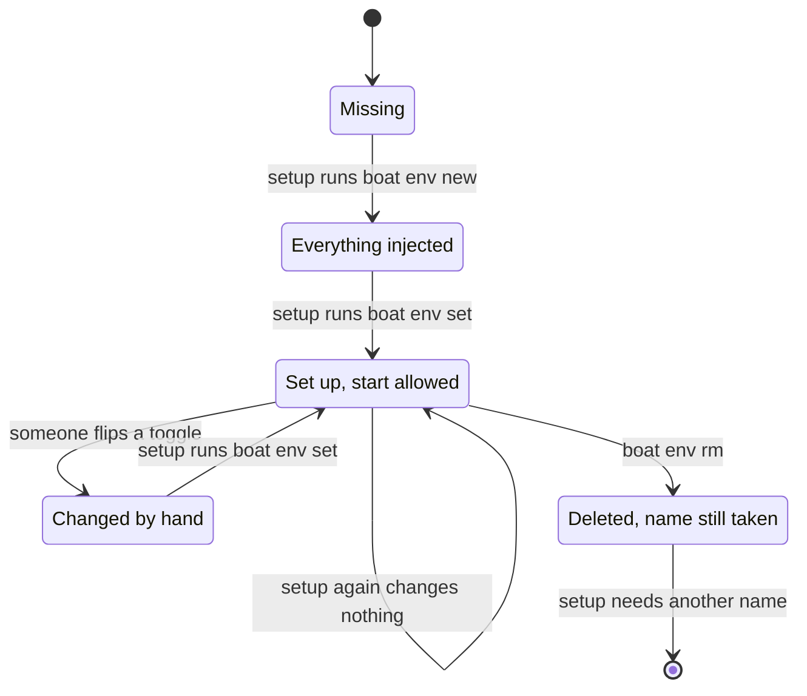

- `start` creates a sandbox only when the environment is set up. In any other state it fails before it creates anything, and says what differs.
- Each change creates a new version of the environment. New sandboxes start from the latest one, and running ones keep theirs.
- `setup` never touches the account's default environment, since your other sandboxes start from it.
- Do not delete the environment with `boat env rm`. Boat only marks it as deleted and keeps its name taken for good, so `setup` can no longer create an environment by that name, and you have to name another one with `--boat-environment` or `environment`.

## Sandbox states

Boat names more states than the adapter needs, so the adapter folds them into these:

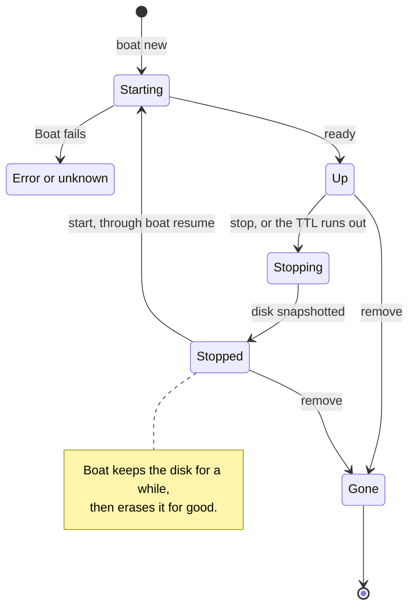

- **Up** means the sandbox accepts ssh.
- **Stopping** means Boat is snapshotting the disk before it stops the machine.
- **Stopped** means nothing runs and the disk is kept, so `workspace start` can bring the sandbox back. Once Boat erases the disk after its retention period, the sandbox can no longer resume.
- **Gone** means Boat answers that the sandbox does not exist.

## What each operation does

### `setup`

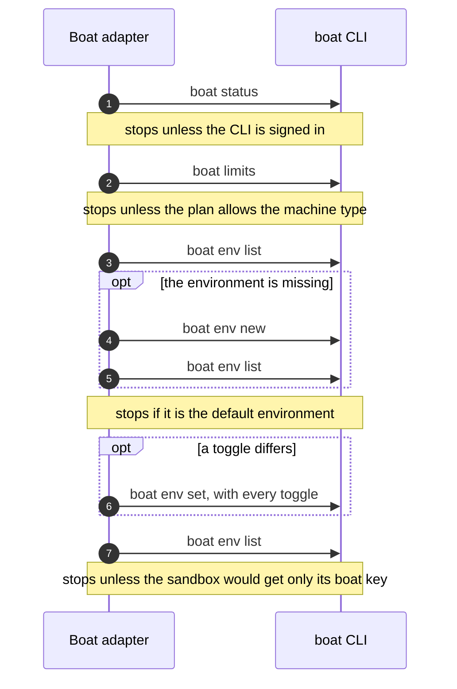

It then prints what `start` will use, and whether it created, reset or kept the environment.

### `create`

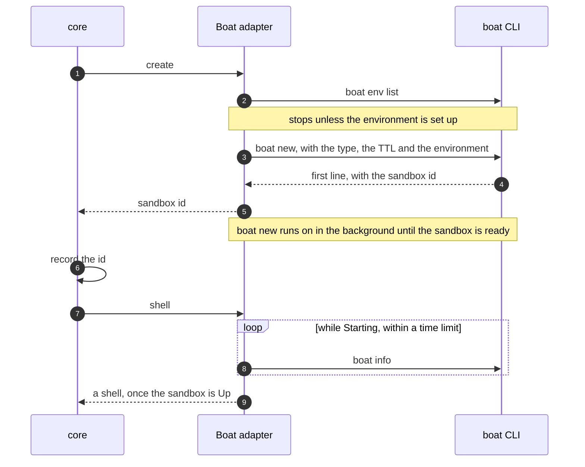

`boat new` prints the sandbox id on its first line, before the sandbox is ready. The adapter returns it at once, which keeps the time without a record short. `shell` then waits through the starting states, and fails at once on a deleted or failed sandbox. It lets a stopped state pass for a short window, since Boat may still report a sandbox it just resumed as stopped, then fails. Boat names sandboxes itself, so the VM name lives only in the record.

### `resume`

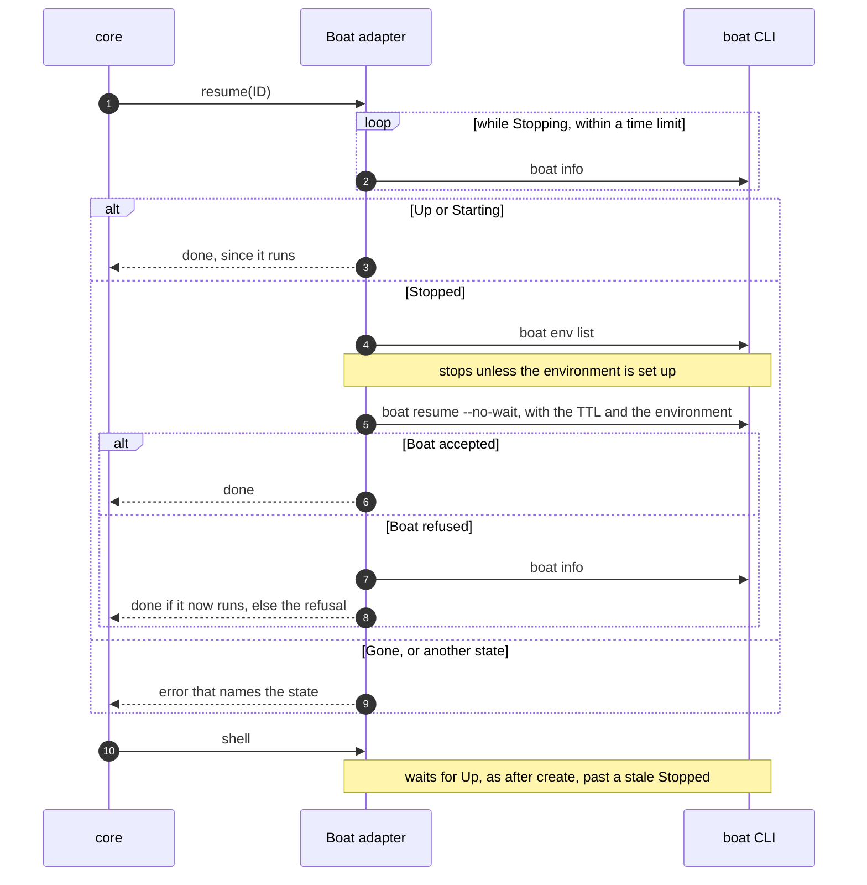

Boat resumes only a stopped sandbox, so one that is still stopping is waited for first. `boat resume` would wait until the sandbox is ready, so the adapter passes `--no-wait`: the call returns once Boat accepts, within its time limit, and `shell` waits for the sandbox as after `create`. Boat may still report the sandbox as stopped for a moment after it accepts, and that same wait lets it pass, so a resume reads the state no more than it must.

A resumed sandbox gets what its environment holds at that moment, so the adapter checks the environment first, as before a create. It then pins the sandbox to that environment, so the sandbox gets the version just checked, even if someone upgraded the environment while the sandbox was stopped. The sandbox keeps its machine type, and its TTL starts again from the resume. A gone sandbox cannot come back: `start` then says that `workspace remove` forgets its record.

### `snapshot`

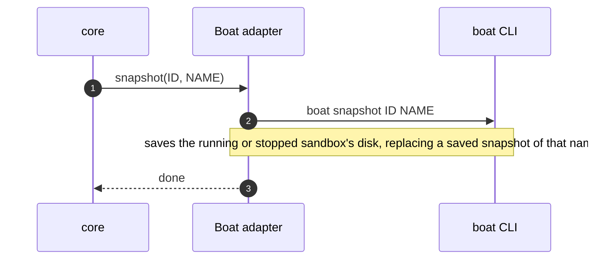

Saving uploads the disk, which takes seconds to minutes, so the call has a long time limit. `boat new --from NAME` then starts new sandboxes from it, with the environment and `--no-snapshots` as usual. A sandbox created from a snapshot is ready in a few seconds with everything the snapshot holds, profiles' work included.

### `attach`

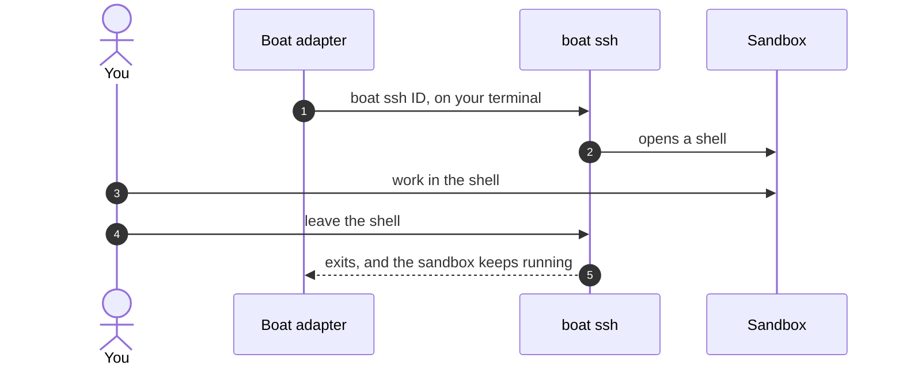

`boat ssh` runs without `--json` here, since its output is the session you read. It has no time limit, since the session lasts as long as you want. Its exit status is that of the last command typed in the session, and Boat's own refusals exit the same way. After a non-zero exit, the adapter therefore reads the state back: a sandbox that still runs means the session ended normally, and one that no longer runs means there was no session to give.

### `Shell::run`, used by profiles

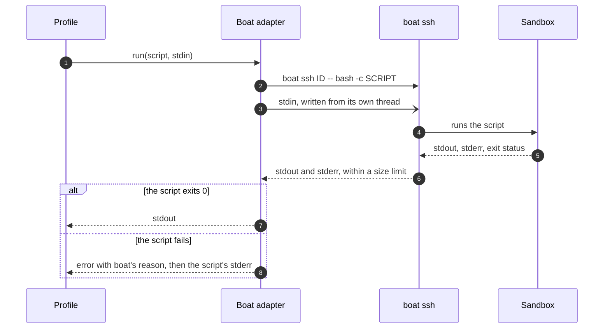

- **Why ssh.** `boat exec` takes no stdin, and Boat stores the command and output of every exec. Secrets could only travel in the command, and would end up stored. `boat ssh` forwards stdin.
- **No time limit.** Provisioning can take long, so a script runs until it ends. Its output has a size limit instead.
- **Telling failures apart.** `boat ssh` exits the same way whether the script failed or Boat refused. Boat's last line tells which, and the adapter reads it.

### `stop`

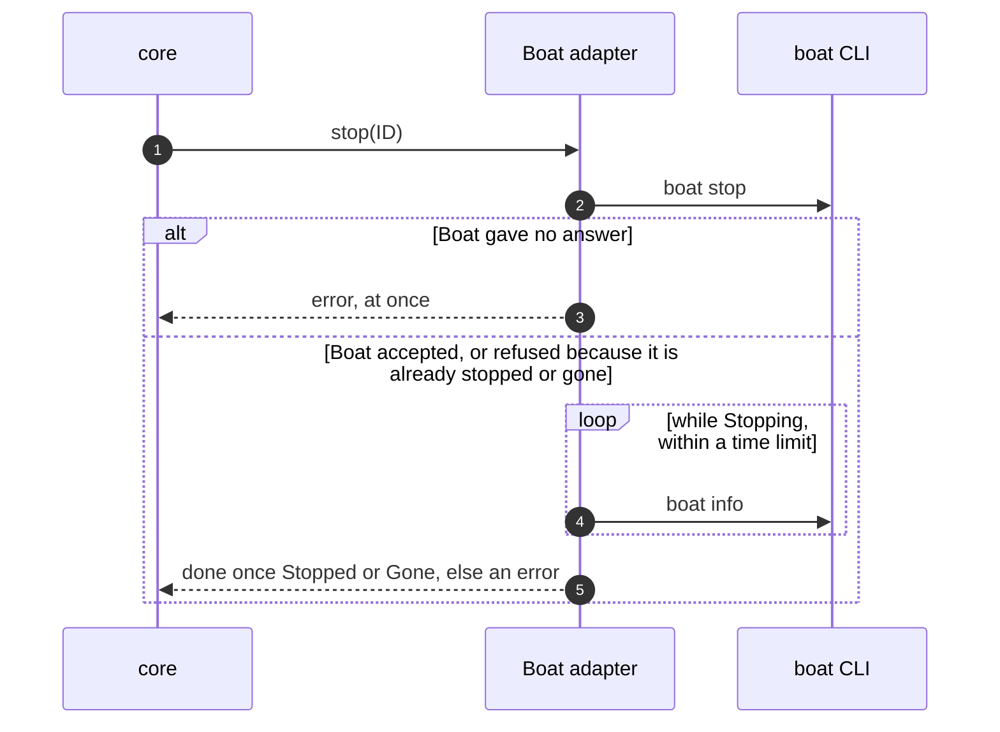

### `remove`

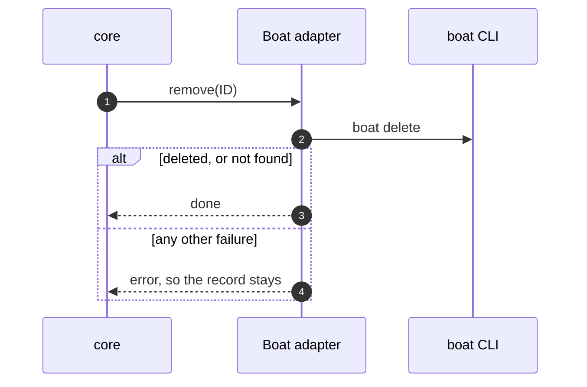

## One call to the boat CLI

Every call skips boat's update check, and every call but the interactive shell asks for JSON output. One module owns every `boat` process, and each call ends in one of these states:

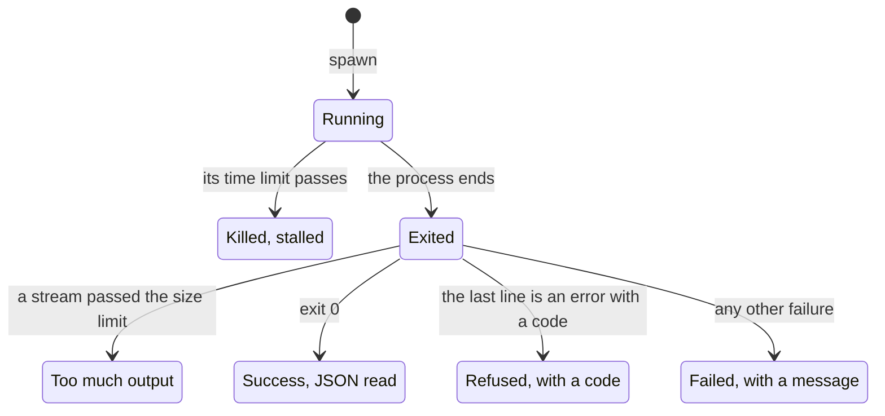

- **Time limit.** A call that only talks to the Boat API gets one, since it should answer within seconds. `boat ssh` gets none.
- **Refused** means the Boat API said no, and its code drives decisions. For example, a not-found code means the sandbox is gone, which `stop` and `remove` treat as success.
- **Failed** carries the message from boat's last line, or its stderr when there is no such line.
- **Stalled.** After a kill, the threads reading the pipes are left behind, so a leftover child process that holds a pipe open cannot delay the error. Boat may still carry out a request it never answered, and the error says so.
- **Too much output.** Past the limit, the rest of a stream is read and dropped, so the command never blocks on a full pipe.
